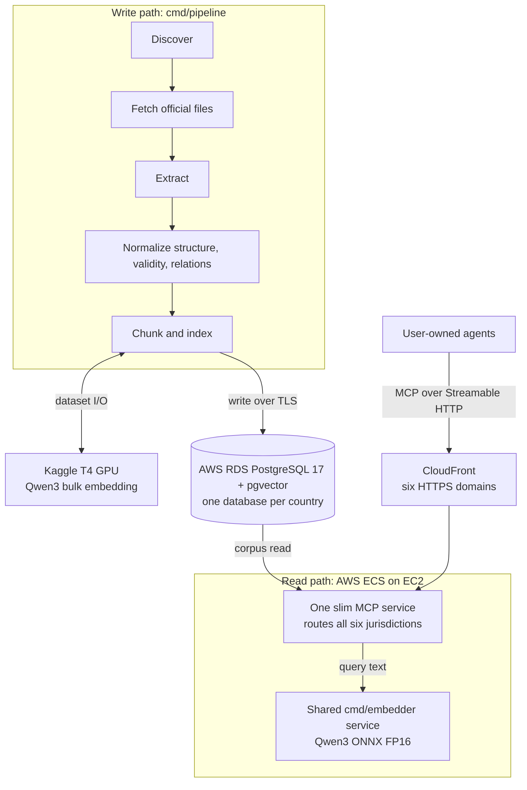

# banhmi

**Development and maintenance have stopped. This repository is retained as an archive.**

Hosted endpoints are unsupported. Deployment and corpus details below are historical.
The roadmap and unfinished work are retained for reference, with no further development planned.

**A citable regulatory corpus and Model Context Protocol (MCP) server for Southeast Asian banking, finance, and technology law.**

[Documentation](docs/README.md) · [Architecture](docs/ARCHITECTURE.md) · [Archived roadmap](PLAN.md) · [Archived work queue](todo.md)

---

banhmi collects legal documents from government, regulator, and supplementary legal-data sources.
It extracts their text and serves ranked evidence over MCP. Results include native citations,
validity, amendment relations, provenance, source links, and known coverage gaps.

banhmi does not answer legal questions. A connected agent retrieves the evidence and forms the
answer.

## Former hosted endpoints

The former public endpoints used MCP over Streamable HTTP without signup or an API key.

Those statements describe the AWS deployment verified on 2026-08-14. The repository
contains a later authenticated Vietnam server composition, but that source has not been deployed or
verified with Google or an MCP client. See the
[authenticated access runbook](deploy/authenticated-access.md) for its unmet release gates.

| Jurisdiction | Endpoint | Search language | Sources |
|---|---|---|---|
| Vietnam | `https://banhmi.danny.vn/mcp` | Vietnamese | VBPL, Cong Bao, government document portal, SBV Region 1 portal |
| Malaysia | `https://laksa.danny.vn/mcp` | English | Attorney General's Chambers, Bank Negara Malaysia, Securities Commission Malaysia |
| Indonesia | `https://rendang.danny.vn/mcp` | Indonesian | BPK JDIH, Bank Indonesia, OJK |
| Singapore | `https://kaya.danny.vn/mcp` | English | Singapore Statutes Online, MAS, PDPC, CSA |
| Thailand | `https://tomyum.danny.vn/mcp` | Thai | Office of the Council of State, Bank of Thailand, SEC, ETDA |
| Cambodia | `https://amok.danny.vn/mcp` | English | NBC, SERC, CDC, Open Development Cambodia |

The former client setup used one endpoint and the search language shown above.
The connected agent could translate the question before searching and translate the retrieved
evidence afterward.

The server exposes five tools:

| Tool | Use |
|---|---|
| `guide` | Read the jurisdiction-specific usage and citation guidance. |
| `corpus_status` | Check live document, source, embedding, relation, and gap counts. |
| `search` | Find ranked provisions with citations, validity, relations, and source links. |
| `document` | Read a full provision and its provenance, relations, and amendment context. |
| `quality_gaps` | Inspect specific corpus-quality worklists before relying on coverage. |

For example, ask: *What are the technology risk management requirements for banks?*

## What it provides

- Scope-filtered discovery for banking and financial regulation plus related technology law,
  including cybersecurity, data protection, artificial intelligence, cloud, electronic
  transactions, payments, and digital banking.
- Text extracted from each cited source without paraphrasing. Each result links back to its source so
  the wording can be checked.
- Native provision structure, such as Vietnamese Điều/Khoản, Indonesian Pasal/ayat, and
  Section/Subsection for Malaysia and Singapore.
- Effective dates, current-law filtering, recorded amendment and repeal relations, provenance, and
  explicit data gaps.
- Hybrid retrieval over dense Qwen3 embeddings and BM25 sparse vectors, fused with reciprocal rank
  fusion (RRF).

Each country has its own corpus and database. Sources and language rules are selected by
configuration, not by maintaining country-specific forks. See the
[source design](docs/design/sources.md) and [jurisdiction registry](docs/design/jurisdictions/README.md).

## Architecture

The ingestion pipeline uses three data layers:

1. **Bronze:** discover and fetch source records and files.
2. **Silver:** extract text and normalize structure, validity, and relations.
3. **Gold:** create provision-aware chunks, dense embeddings, and BM25 sparse vectors.

The recorded deployment ran one slim MCP service for all six jurisdictions and one shared query-embedding
service. PostgreSQL is the jurisdiction boundary: each country has a separate database. See
[Architecture](docs/ARCHITECTURE.md) and [Deployment](docs/DEPLOYMENT.md).

## Corpus and retrieval status

These corpus sizes were verified in production on 2026-08-14. The evaluation metrics are accepted
offline baselines recorded from 2026-07-25 through 2026-07-27. These are historical counts.

| Jurisdiction | Chunks | Golden cases | Recall@8 | MRR@8 | Current-law precision | Abstention |
|---|---:|---:|---:|---:|---:|---:|
| Vietnam | 142,086 | 92 | 93.8% | 73.3% | 100% | 100% |
| Malaysia | 11,304 | 72 | 94.3% | 79.6% | 100% | 100% |
| Indonesia | 160,142 | 110 | 79.8% | 62.4% | 100% | 100% |
| Singapore | 27,951 | 76 | 93.5% | 76.9% | 100% | 98.7% |
| Thailand | 32,715 | 58 | 89.5% | 69.6% | 100% | 96.6% |
| Cambodia | 7,757 | 42 | 94.4% | 72.7% | 100% | 100% |

Recall@8 measures whether expected citations appear in the first eight results. Current-law
precision measures whether returned primary hits are in force. Abstention measures whether the
retriever flags questions that lack usable in-scope evidence. See the
[evaluation design](docs/design/rag.md#retrieval-evaluation) and [roadmap](PLAN.md) for details and
known gaps.

## Archived development and self-hosting guides

Read [Development and verification](docs/DEVELOPMENT.md) for the hosted contribution workflow,
initial GitHub checks, and checks that still need hosted infrastructure. The
[repository cleanup plan](docs/plans/repository-cleanup.md) records the unfinished documentation and CI
work.

Self-hosting requires PostgreSQL 17 with pgvector, the Go services, and a matching
Qwen3-Embedding-0.6B query embedder. Building a corpus can also require object storage, bulk
embedding, OCR, and source-specific network access. [Deployment](docs/DEPLOYMENT.md) defines the
portable runtime contract and reference deployment.

## Documentation

- [Documentation index](docs/README.md)
- [Architecture](docs/ARCHITECTURE.md)
- [Development and verification](docs/DEVELOPMENT.md)
- [Contributor instructions](AGENTS.md)
- [Archived repository cleanup plan](docs/plans/repository-cleanup.md)
- [Deployment](docs/DEPLOYMENT.md)
- [Publishing](docs/PUBLISHING.md)
- [Archived roadmap and status](PLAN.md)
- [ASEAN Banking MCP redesign proposal](docs/design/asean-banking-mcp.md)
- [Source, pipeline, schema, extraction, retrieval, and workflow evaluation designs](docs/README.md#design-documents)
- [Jurisdiction registry and country guides](docs/design/jurisdictions/README.md)

## License

[Apache 2.0](LICENSE).
