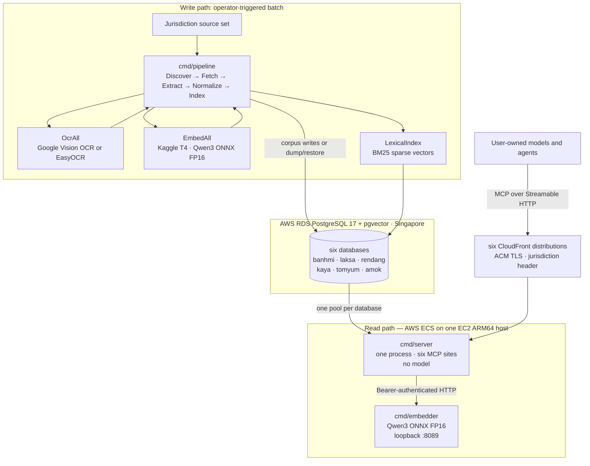

# banhmi architecture

banhmi builds a retrieval-augmented generation (RAG) corpus for Southeast Asian banking and
financial regulation and related technology law. It serves evidence over the Model Context Protocol
(MCP): verbatim legal text, native citations, validity, relations, provenance, and coverage gaps.

banhmi does not answer legal questions. A user-owned model connects to MCP, retrieves evidence, and
decides the answer. There is no answer model or answer API in this system.

The same code serves six live jurisdictions. Each jurisdiction has its own sources, parser, indexed
language, database, MCP brief, domain, and evaluation set. Shared ingestion, extraction, retrieval,
and MCP code is selected through the jurisdiction registry in `pkg/base/jurisdiction`.

| Country | Code | Corpus database | Indexed language | Public MCP endpoint | Sources |
|---|---|---|---|---|---|
| Vietnam | `vn` | `banhmi` | Vietnamese | `https://banhmi.danny.vn/mcp` | `congbao`, `vbpl`, `vanban`, `sbv_hanoi` |
| Malaysia | `my` | `laksa` | English | `https://laksa.danny.vn/mcp` | `agclom`, `bnm`, `sc` |
| Indonesia | `id` | `rendang` | Indonesian | `https://rendang.danny.vn/mcp` | `bpk`, `bi`, `ojk`, `ojkweb` |
| Singapore | `sg` | `kaya` | English | `https://kaya.danny.vn/mcp` | `sso`, `mas`, `pdpc`, `csa` |
| Thailand | `th` | `tomyum` | Thai | `https://tomyum.danny.vn/mcp` | `ocs`, `bot`, `etda`, `sec` |
| Cambodia | `kh` | `amok` | English | `https://amok.danny.vn/mcp` | `nbc`, `serc`, `cdc`, `odc` |

Cambodia is the language-policy exception. Its corpus indexes English translations published by the
source sites, but Khmer is the binding language. Those English texts are not the binding originals.
banhmi does not translate legal text in any jurisdiction. See the
[jurisdiction registry](design/jurisdictions/README.md) and
[jurisdiction playbook](design/jurisdictions/PLAYBOOK.md).

## System overview

The deployed system has a batch write path and an always-on read path. PostgreSQL is their only
shared state. The diagram below describes the current AWS deployment.

The approved Vietnam target moves serving, the corpus writer and workers, review services, and
artifact and backup storage to VNGCloud in Vietnam. Writer and worker capacity stay separate from
the serving host. The target is unimplemented; existing AWS services remain deployed until the
Vietnam cutover, and the five other country services stay unchanged. See the
[hosting decision](specs/corpus-write-path.md#decisions).



The production EC2 host and RDS instance run 24/7. The former EventBridge start and stop schedules
are disabled and retained only for rollback.

## Design principles

| Principle | Consequence |
|---|---|
| Evidence only | MCP returns source evidence and explicit uncertainty. The connecting model answers. |
| Data accuracy first | Deterministic extraction and source metadata take precedence over generated interpretation. |
| One database per jurisdiction | The database is the isolation boundary. Data tables do not carry a jurisdiction column. |
| One shared codebase | The registry selects sources, parsers, citation labels, scope policy, and the MCP brief. The pipeline uses `BANHMI_JURISDICTION`; a multi-site server uses `BANHMI_JURISDICTIONS`. |
| Database handoffs | Pipeline stages exchange state through PostgreSQL. No workflow service or in-memory queue connects stages. |
| Required hybrid retrieval | Production search uses dense Qwen3 embeddings and BM25 sparse vectors. An unavailable query embedder returns an error rather than silently changing retrieval behavior. |
| Source fidelity | The corpus retains raw source material, hashes, extraction authority, review status, and source URLs. |
| Explicit legal currency | Current law leads search. Non-current evidence remains findable with a badge. banhmi does not infer clause-level legal effect. |

## Write path

`cmd/pipeline` runs five direct stages. Each stage can run alone, and `-run-all` sequences them. There
is no Temporal deployment.

| Stage | Reads | Writes |
|---|---|---|
| Discover | Source listings and configured scope policy | `ingest` cursors, document ledger, artifact plan, and discovery provenance |
| Fetch | Pending artifact leases | Raw metadata, payloads, and files in `bronze` |
| Extract | Completed Bronze documents | Candidate document text and extraction provenance in `silver` |
| Normalize | Extracted text and structured source data | Logical documents, provision trees, validity, and relation evidence in `silver` |
| Index | Normalized primary documents | Provision-aware chunks in `gold` |

`-run-all` discovers every enabled source, then repeats relation backfill, Fetch, Extract, and
Normalize to a bounded convergence depth. It then runs batch OCR, Index, bulk embedding, and the
lexical index rebuild. The `ingest` ledger supplies crash-safe leases, retries, dead-letter state,
and completeness checks. A document is complete only when its completed artifact count matches its
expected artifact count.

The reference deployment still uses operator-triggered pipeline runs. Production corpora are loaded
into RDS through logical dump and restore; a pipeline host may also write to RDS over TLS. The hosted
development policy places future corpus work on isolated CI or cloud workers, but that migration is
not complete. Parked in-country EC2 workers and source-specific proxies provide egress for
geo-restricted sources when a refresh needs them. Bulk document embedding uses Kaggle dataset input
and output. Kaggle is not part of query-time serving.

See [Pipeline](design/pipeline.md) for stage contracts and
[Sources](design/sources.md) for discovery and fetch behavior.

## Extraction and normalization

Extraction prefers deterministic source text in this order: DOCX, text-bearing HTML, legacy DOC,
then PDF. go-fitz reads DOCX and born-digital PDF. HTML uses the deterministic HTML extractor.
LibreOffice converts legacy DOC to DOCX before extraction.

The Go HTML and DOCX reader implementations live in `internal/corpus/conversion`.
`pkg/extract` keeps compatible entry points and supplies the existing Vietnamese DOCX heading rule.
The Go DOCX reader is not wired into the active pipeline. These readers still emit legacy text;
block-model conversion and its acceptance gates remain unimplemented. The
[conversion plan](plans/document-conversion.md) records source review and hosted evidence separately.

Each candidate text passes a per-file quality gate. The gate checks length, replacement characters,
language-specific corruption markers, whitespace, scan layers, and other configured signals. Failed
or scanned PDFs are marked for the separate `OcrAll` batch. Google Vision OCR is the default;
EasyOCR is the local or Kaggle fallback. OCR text remains non-binding and carries review status.

Normalization emits the jurisdiction's native provision tree and citation labels, such as
`Điều/Khoản`, `Section/Subsection`, `Pasal/ayat`, `มาตรา/วรรค`, or `Article/Clause`. It also reconciles
cross-source aliases, stores source validity without inventing dates, and separates confirmed
relations from weak text-derived evidence. Source-provided structure and relations are ingested
directly when available.

All text is Unicode NFC. banhmi never translates or diacritic-folds stored legal text. See
[Extraction](design/extraction.md).

## Data architecture

One PostgreSQL 17 server with pgvector holds six independent databases. Each database has the same
five schemas.

| Schema | Role | Main data |
|---|---|---|
| `ingest` | Pipeline state and completeness | cursors, fetch ledger, artifact leases, discovery provenance, embedding cache |
| `bronze` | Raw source capture | source observations, inline payloads, file paths, hashes |
| `silver` | Normalized legal evidence | logical documents, text authority, provision trees, validity periods, relations, aliases |
| `gold` | Retrieval index | chunks, dense embeddings, BM25 sparse vectors |
| `config` | Operator-tunable policy | scope terms, issuers, discovery keywords, validity and relation mappings, settings |

Raw PDF, DOCX, DOC, HTML, and OCR cache files stay outside PostgreSQL. When an S3 data bucket is
configured, local content-addressed files are mirrored under `files/` and `ocr/`. PostgreSQL stores
paths, hashes, metadata, and provenance.

Important data-model boundaries:

- One source observation can contain many files. Natural unique keys make re-fetches idempotent.
- `silver.document` represents one logical document deduplicated across sources.
- `silver.doc_ref` can represent a relation target before that target is ingested.
- Only promoted relation evidence creates a confirmed `document_relation` edge.
- Validity is stored as observed effective-dated periods. MVP1 legal currency is document-level.
- Gold chunks use deterministic context prefixes and native citations. Embeddings are keyed by
  chunk, model, and dimensions.

See [Data model](design/schema.md).

## Retrieval and MCP

MCP is the only query surface in the deployed AWS service. Both `cmd/mcp` over stdio and the deployed
`cmd/server` over Streamable HTTP expose the same five tools: `guide`, `corpus_status`,
`quality_gaps`, `search`, and `document`. The authenticated source also exposes website search and
document views through the same evidence operations. That website has not been deployed.

Production search follows this path:

1. The MCP server validates scope and optional filters, then sends the query to `cmd/embedder`.
2. `cmd/embedder` returns a 1,024-dimension Qwen3-Embedding-0.6B vector. A startup parity probe checks
   model identity and dimensions before the MCP server accepts traffic.
3. PostgreSQL ranks dense vectors and BM25 `sparsevec` vectors. Reciprocal rank fusion (RRF) combines
   the arms, with jurisdiction-specific query routing and tokenization.
4. Current or partially current law leads the primary pass. A small secondary pass can append
   repealed, expired, not-yet-effective, or unknown-validity evidence with explicit badges.
5. The result attaches citations, full-provision pointers, validity, confirmed relations, source
   provenance, and gaps. Relations provide context but do not replace ranked text evidence.

The query embedder is a separate service because each ONNX Runtime process holds its own model
memory. One shared embedder and one multi-jurisdiction MCP process avoid loading the model once per
country. The embedder has no database credentials or MCP logic. An in-process ONNX embedder remains
available for isolated integration checks and rollback.

The lexical arm uses pgvector `sparsevec`; the deployment does not use ParadeDB, `pg_search`, or a
separate search service. See [RAG evidence](design/rag.md).

## Production deployment and security

The reference production stack runs in AWS Singapore (`ap-southeast-1`).

| Component | Current shape | Exposure and controls |
|---|---|---|
| CloudFront | Six distributions and domains with ACM certificates | Public HTTPS entry point. Each distribution injects its jurisdiction and an origin-verification secret. |
| MCP service | One slim `cmd/server` ECS service on an EC2 `t4g.medium` ARM64 host | Serves all six sites. The host security group accepts service traffic only from the CloudFront origin-facing prefix list. |
| Query embedder | One `cmd/embedder` ECS service on the same host | Binds to `127.0.0.1:8089`, requires a shared Bearer token, and has no database credentials. |
| Database | One private RDS PostgreSQL 17 `db.t4g.micro` instance with six databases | No public IP. Port 5432 is allowed from the origin security group; maintenance temporarily allowlists a maintainer `/32`. TLS and password authentication are required. |
| Secrets | AWS Systems Manager Parameter Store SecureStrings | ECS injects the database password, origin secret, and embedder token. Runtime containers do not read AWS APIs directly. |
| Backups | Per-database logical dumps in S3 | RDS automated backups are currently disabled. |

The MCP endpoints are public and require no user API key in the current deployment. The deployed
server middleware enforces the CloudFront origin secret, per-client-IP rate limits, a 1 MiB
request-body limit, cross-origin checks, and request timeouts. OAuth is not part of the deployed
runtime.

The current source also contains an authenticated single-origin `cmd/server` composition for a later
Vietnam cutover. It creates a separate authentication pool, requires Google registration for the
website, and accepts only resource-bound OAuth bearer tokens at `/mcp`. Website and MCP adapters share
one Vietnam evidence server. The process validates the canonical HTTPS origin, Google settings,
encryption keys, and versioned client allowlist before opening runtime dependencies. It rejects every
non-health request whose `Host` differs from the configured origin authority. It does not use
forwarded host headers or jurisdiction headers to select another corpus.

The authenticated composition passed independent review and GitHub generation, build, vet, short
tests, isolated PostgreSQL integration, and synthetic browser checks. The
[implementation plan](plans/google-access.md#progress) records the tested commit and run. Real Google,
named-client, and deployed-browser smoke checks, deployment, and production verification remain
pending. The public AWS behavior above remains the deployed architecture. See the
[authenticated access runbook](../deploy/authenticated-access.md).

The MCP and embedder run as non-root containers with read-only root filesystems and all Linux
capabilities dropped. ECS uses an execution role only for image pulls, log delivery, and SSM secret
injection. See [Deployment](DEPLOYMENT.md).

## Corpus source refactor

The [approved source plan](plans/corpus-redesign-source.md) separates serving composition into
`internal/app/serve`, evidence contracts and operations into `internal/evidence`, and corpus control
code into `internal/corpus`. The source pass and independent static review are complete. Runtime
verification remains pending. Existing workers remain in `pkg/pipeline`; their current mutations
do not have the new build fencing contract.

Canonical SQL additions describe immutable revisions, subjects, builds, and releases. Hosted sqlc
and migration generation must precede durable adapter wiring. The current service still reads its
existing pool through a compatibility pin, reports no immutable release ID, and rejects named
release requests. The public AWS deployment has not changed.

Pure rune estimation and text splitting live in `internal/corpus/chunking`. Existing pipeline entry
points forward to these helpers and retain their token cap, citations, prefixes, and storage behavior.
The [chunking layout plan](plans/chunking-layout.md) records hosted checks and pending corpus evidence.

## Repository layout

```text
banhmi/
├── cmd/
│   ├── pipeline/          # direct batch pipeline and repair operations
│   ├── server/            # authenticated website and Streamable HTTP MCP service
│   ├── mcp/               # local stdio MCP service
│   ├── embedder/          # standalone query embedding HTTP service
│   ├── migrate/           # database migration runner
│   ├── seed/              # config seed loader
│   ├── eval/              # retrieval and workflow evaluation
│   └── lexindex/          # standalone BM25 sparse-vector rebuild
├── pkg/
│   ├── app/               # dependency composition and jurisdiction source wiring
│   ├── base/              # config, database, DNS, logging, jurisdiction registry
│   ├── ingest/            # one package per source
│   ├── fetch/             # shared HTTP and anti-bot transport
│   ├── extract/           # deterministic extraction and OCR adapters
│   ├── pipeline/          # pipeline stages, batch work, and targeted repairs
│   ├── rag/               # embedding, lexical indexing, OCR batch, retrieval
│   ├── mcp/               # MCP tools, briefs, and evidence schemas
│   ├── identity/          # Google login and website sessions
│   ├── oauthserver/       # MCP OAuth metadata, consent, tokens, and bearer checks
│   ├── web/               # public pages and account evidence workspace
│   ├── scope/             # database-seeded scope matcher
│   ├── eval/              # evaluation logic
│   └── store/             # generated sqlc packages
├── sql/                   # source schemas and sqlc queries
├── deploy/                # corpus and auth migrations, runbooks, containers, and AWS definitions
├── config/                # example and container configuration
├── docs/design/           # detailed source, pipeline, schema, extraction, and RAG designs
├── tools/                 # maintenance and evaluation helpers
├── README.md
└── PLAN.md
```

## Technology choices

| Concern | Choice |
|---|---|
| Application | Go 1.26.3, module `danny.vn/banhmi` |
| Dependency wiring | `go.uber.org/dig` |
| Database access | pgx and sqlc; no ORM |
| Database | PostgreSQL 17 with pgvector HNSW and `sparsevec` |
| Migrations | Atlas-generated, goose-format SQL applied by `cmd/migrate` |
| MCP | Official Go MCP SDK; stdio and Streamable HTTP |
| Dense embedding | Qwen3-Embedding-0.6B ONNX FP16, 1,024 dimensions |
| Lexical retrieval | BM25 vectors stored as pgvector `sparsevec` |
| Extraction | go-fitz/MuPDF, deterministic HTML extraction, LibreOffice DOC bridge |
| OCR | Google Vision OCR by default; EasyOCR fallback |
| Containers | OCI images built with podman; production runs on ECS on EC2 ARM64 |
| License | Apache 2.0 |

Detailed documents are indexed in [docs/README.md](README.md). The roadmap and measured corpus state
live in [PLAN.md](../PLAN.md); this document describes the current architecture rather than its change
history.
