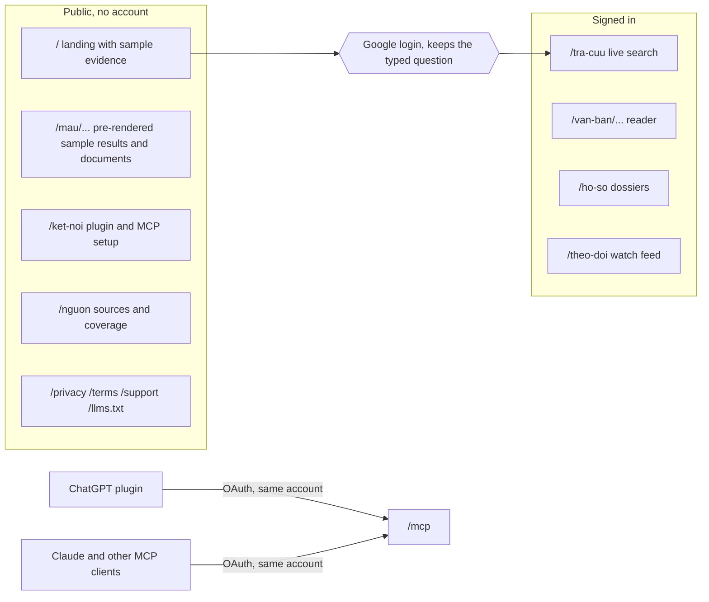
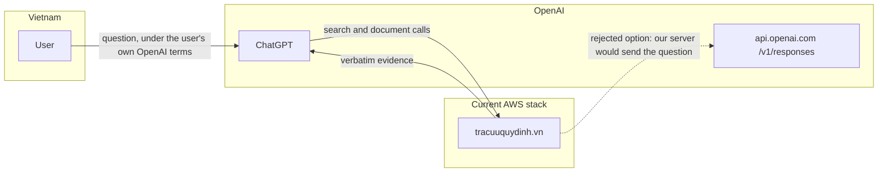

# tracuuquydinh.vn website and ChatGPT plugin

**Status:** proposal, 2026-10-11. Nothing in this design is implemented or deployed. It builds on the
coded Google access source described in [Authentication](AUTH.md) and revises that design's public
routes and login boundary. The owner approved the product direction from a design review; this
document turns it into a specification for implementation planning.

## Decisions

- **Name and domain.** The Vietnam product is **Tra cứu quy định** at `tracuuquydinh.vn`. `banhmi`
  remains the name of the engine, repository, and corpus.
- **Vietnam only.** The website and plugin serve the Vietnam corpus. The five other country services
  keep running unchanged on their `danny.vn` hostnames for now. This design does not add, remove, or
  change them.
- **Evidence workbench.** The website helps a person find a provision, verify that it applies on a
  date, keep it in a citation dossier, and export it. It is not a general search box.
- **The user brings the AI.** Our servers run no generative model and never send a user's question
  to a model provider. The existing query embedder stays on our host. Users ask questions in ChatGPT through our plugin, or in Claude and other MCP
  clients through `/mcp`. Amazon Bedrock and any paid tier are out of scope.
- **Vietnamese questions only.** Every search question, on the website, in the plugin, and over MCP,
  must be in Vietnamese. English is available for interface text only. Reason: machine translation
  is not reliable enough for Vietnamese legal terms.
- **Open door first.** Public pages show real sample evidence, sources, coverage, and connection
  steps before asking for an account. Google login gates live search, the reader, saved state, and
  MCP.
- **Legal-document visual direction.** The interface uses document numbers, Điều/Khoản/Điểm
  citations, and validity stamps as its visual material. The theme follows the device setting; light
  is the reference design.

## Users and the core job

Primary users are compliance, legal, risk, and IT security staff at Vietnamese banks, payment
intermediaries, and fintechs, plus their auditors and vendors. Their job is to cite the provision
that applies on a given date and to show where it came from.

The website supports one loop:

1. **Find:** search in Vietnamese with filters.
2. **Verify:** read the validity stamp, the effective dates, and the documents that amend, replace, or
   repeal it.
3. **Keep:** pin the provision to a citation dossier.
4. **Export:** copy citations, export a document, or hand the dossier to the user's own AI.

## Site map and access boundary

Route changes relative to [Authentication](AUTH.md):

| Route | Access | Change |
|---|---|---|
| `GET /` | Public | Replace the three-card page with the landing described below. |
| `GET /mau/{slug}` | Public | New. Static sample results and sample documents built at release time. |
| `GET /ket-noi` | Public | Replaces `/connect`, which required a session. Shows no secrets. |
| `GET /nguon` | Public | New. Sources, coverage, and known gaps from `corpus_status` at release time. |
| `GET /tra-cuu` | Web session | Replaces `/app`. |
| `GET /van-ban/{document}` | Web session | New. Full-page reader with a provision anchor. |
| `GET /ho-so`, `GET /theo-doi` | Web session | Phase 2. |
| `POST /api/v1/search`, `POST /api/v1/document` | Web session, Origin and CSRF | Unchanged contract; the website sends the existing filter fields. |

The login `next` allowlist changes from `/app` and `/connect` to the signed-in page paths above, with
an optional query string for `/tra-cuu` limited to the search parameters. All other `next` rules in
[Authentication](AUTH.md) stay. Public sample pages are static files produced from real corpus
responses during release. They make no anonymous evidence calls, so the anonymous rate-limit surface
does not grow.

## Language

| Surface | Vietnamese | English |
|---|---|---|
| Search questions: website, plugin, MCP | Required | Rejected |
| Legal text and citations | Verbatim | Never translated |
| Interface text: menus, buttons, stamps, notices | Default | Optional |
| Plugin name, description, and tool descriptions | Required | Not provided |

The service accepts a query when it contains Vietnamese letters with diacritics or when it is a
document number such as `50/2024/TT-NHNN`. Vietnamese typed without diacritics is rejected with a
request to add them. Otherwise the website shows a notice in the interface language, and `search` returns no hits with `abstain: true` and a blocking gap whose message asks for a
Vietnamese question. The gap kind is additive, so the five-tool MCP contract keeps its shape.

The Vietnam MCP instructions change from "translate the question to Vietnamese first" to "accept
Vietnamese questions only; ask the user to rephrase in Vietnamese". This cannot stop a client model
from translating silently before it calls `search`; the instructions forbid it, but there is no
technical barrier.

## AI and the data boundary

[Điều 20 khoản 1 điểm c Luật Bảo vệ dữ liệu cá nhân 91/2025/QH15](https://vbpl.vn/van-ban/chi-tiet/179252)
treats processing personal data collected in Vietnam on a platform outside Vietnam as a cross-border
transfer, and khoản 2 requires an impact-assessment dossier within 60 days. This evidence, not a
legal conclusion, drives three choices:

- **ChatGPT plugin (selected).** The user sends the question to OpenAI under their own account. Our
  server receives only tool calls and returns public legal text.
- **Platform-run model, including Amazon Bedrock (rejected).** Our server would send user questions
  abroad.
- **Sign in with ChatGPT on our website (deferred).** OpenAI documents it as a
  [limited trial for selected commercial partners](https://developers.openai.com/siwc/website), and
  our server would send questions to `/v1/responses` with the user's token, which is the same
  transfer as Bedrock.

All services stay on the current AWS stack until the owner decides otherwise. Our server still sends
no question to a model provider, but the AWS host and the Google login sit outside Vietnam, so both
need assessment under the same law before launch.

## Visual system

- **Type roles:** Be Vietnam Pro for interface text, Noto Serif for verbatim legal text, Roboto Mono
  for document numbers and citations. Serve the font files from our origin; the current CSP needs a
  `font-src 'self'` directive. No third-party font or script host.
- **Validity stamps:** a double-ruled uppercase label in one of four inks, always in the same place on
  a card. Còn hiệu lực (green), Còn hiệu lực một phần (amber), Chưa có hiệu lực (blue), Hết hiệu lực
  and Đã bãi bỏ (red). Stamp labels follow the interface language.
- **Card order:** citation, stamp, one context line with the date and acting document, verbatim text,
  actions. Long warnings never go inside a stamp.
- **Theme:** follow `prefers-color-scheme`. Light is the reference. Dark uses the same four inks with
  raised lightness for contrast. No theme toggle in phase 1.
- **Accessibility:** `lang="vi"` on legal text, accessible names that include the document number on
  repeated actions, Escape and focus return on overlays, and non-text contrast of at least 3:1.

## Phase 1: website on the current API

**Landing (`/`).** The headline asks "Điều khoản nào đang có hiệu lực?". The page shows real sample
cards, including a repealed provision, sample questions that open `/mau/` pages, coverage facts, the
official source list, the plugin and MCP setup link, and the structured data and llms.txt that the
current landing provides.

**Search (`/tra-cuu`).**

- A summary bar counts results by validity and lists gap kinds with their document numbers.
- Gaps tied to a result appear on that card. Only `abstain` and blocking gaps sit above the results.
- Lifecycle relations (replaced by, repealed by, amended by, consolidated in) show as chips that carry
  the target's status. Legal-basis relations collapse under one disclosure.
- Expired results group under "Văn bản lịch sử" below current results.
- Filters use existing search fields: `in_force_only`, `as_of`, `issuer`, `doc_type`, `issued_from`,
  and `issued_to`.
- Enter submits; Shift+Enter adds a line. The hero shrinks after the first search.

**Applies on date.** A date control sets `as_of`. Today this filters at document level only, and
documents without a recorded effective date drop out of the results; the page says so.

**Lineage.** From a document, show the chain of replaces, repeals, and amends relations on a
year-scaled timeline built from the `document` relations and validity periods. Bound the walk by depth
and node count. Draw a dashed segment where no confirmed relation exists.

**Reader (`/van-ban/{document}`).** A table of contents from Chương, Mục, and Điều; Điều numbers in a
margin gutter; verbatim text scrolled to the requested provision; a side rail with validity, incoming
amendments, outgoing relations, collapsed legal basis, and sources with file hashes; raw JSON behind
one toggle. On phones the reader is a full page with a back action.

**Dossier, browser-local.** Pin provisions into named dossiers stored in browser storage. Each entry
keeps the citation in Vietnamese legal order ("khoản 1 Điều 3 Thông tư số 50/2024/TT-NHNN"), the
status on the dossier's applies-on date, the source URL, and the file hash. Repealed entries stay,
marked as historical. Actions: copy citations, and **Gửi sang AI**, which copies a plain-text evidence
block with instructions for the user's model.

## Phase 2: accounts and the plugin

- **ChatGPT plugin** in the ChatGPT Directory, in Vietnamese, using the existing MCP tools and OAuth.
  Optional plugin UI renders the evidence card with its stamp inside ChatGPT. The plugin follows the
  [plugin guidelines](https://developers.openai.com/plugins/plugin-guidelines.md): a published privacy
  policy, minimum permissions, and no reconstruction of chat logs.
- **Server-side dossiers** with sharing, and DOCX export.
- **Watch feed** for followed documents and dossiers, generated from relation and validity changes at
  corpus refresh. Weekly email is optional and needs a mail service and a privacy-notice update.
- Server-side dossiers and watches store document identifiers and citations only. No query text and
  no query history, as [Authentication](AUTH.md) already requires.

## Phase 3: depends on the corpus redesign

These need the [corpus and workflow redesign](CORPUS-PIPELINE-REDESIGN.md) and are not website work:

- **Provision-level validity.** A search hit carries only document status today. Example: khoản 1
  Điều 25 of 09/2020/TT-NHNN appears as "Partially in force" although khoản 6 Điều 22 of
  50/2024/TT-NHNN repeals that Điều from 2025-01-01.
- **Amendment targets.** `incoming_amendments.position` locates the clause in the amending document;
  the target provision exists only in the clause text. The redline view needs the target as a field.
- **Relation attribution.** The incoming amendments of 09/2020/TT-NHNN list six clauses of
  50/2024/TT-NHNN; only one, "Bãi bỏ Điều 25 của Thông tư số 09/2020/TT-NHNN", names it. Review relation extraction before building on it.
- **Validity warning wording.** A partial repeal is described as contradictory source metadata.
- Redline view, release identifiers in every citation, durable evidence keys in URLs, and subject
  filters.

## Not in scope

- A model run by us, on any provider, and AI-written text in search results.
- A paid tier.
- Other countries on `tracuuquydinh.vn`.
- Translation of questions or legal text.
- Query history, stored PDF copies, comments, and team collaboration.

## Changes to other documents

| Document | Change |
|---|---|
| [Authentication](AUTH.md) | This design revises its route table and `next` allowlist. Update both when phase 1 is planned. |
| [ASEAN proposal](ASEAN-BANKING-MCP.md) | Country expansion, the working name, and the VNGCloud transition are superseded: all services stay on AWS until the owner decides otherwise. One-domain access and subject organization remain. |
| [Jurisdiction playbook](jurisdictions/PLAYBOOK.md) | Vietnam becomes an exception to "a connecting model may translate a question before search". |
| [Publishing](../PUBLISHING.md) | Only the Vietnam plugin is planned, in Vietnamese, behind OAuth, so review needs a demo account. |
| `pkg/mcp/brief.go` | Vietnam language guidance changes as described under Language, in phase 1. |

## Verification

Hosted checks only, per [verification](../../instructions/verification.md):

- browser checks of public pages with no session, at phone and desktop widths, in both themes;
- CSP checks with self-hosted fonts and no third-party hosts;
- language-gate tests for Vietnamese, unaccented text, English, and document numbers on the website
  and on `search`;
- `next` allowlist tests for every new path;
- real-document checks that sample pages, lineage, and reader content match `search` and `document`
  responses for the same release.

The public route and `next` changes touch authentication, so they require an adversarial review before
merge.

## Open questions

1. What happens to `banhmi.danny.vn`: an early redirect, the cutover notice in
   [Authentication](AUTH.md), or both?
2. Plugin review needs a demo account. Google-only login makes a reviewer account without
   multifactor prompts uncertain.
3. Which ChatGPT plans can use Directory plugins is unconfirmed.
4. What does the cross-border assessment of the AWS host and Google login conclude, and does it
   change the AWS region?
