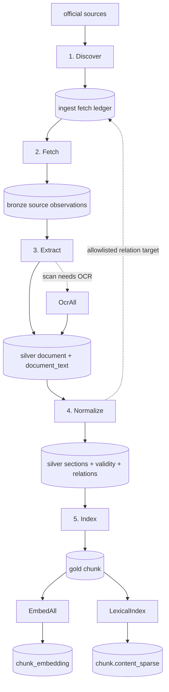
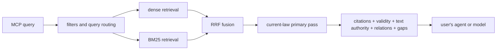

# Pipeline

banhmi has a write path and a read path. `cmd/pipeline` builds each jurisdiction's corpus. The MCP
server reads that corpus and returns evidence; it does not write answers.

See [ARCHITECTURE.md](../ARCHITECTURE.md) for the system boundary, [schema.md](schema.md) for tables,
[sources.md](sources.md) for crawl contracts, [extraction.md](extraction.md) for text extraction, and
[rag.md](rag.md) for retrieval.

The [corpus source pass](../plans/corpus-redesign-source.md) adds bounded batch commands. Those edits
have not run or changed the deployed pipeline. Hosted verification remains required.

## Write path

The five document stages are:

1. `Discover`
2. `Fetch`
3. `Extract`
4. `Normalize`
5. `Index`

Each stage is a direct Go method call. The database is the handoff, and no document stage starts the
next stage by itself.

Three batch operations complete or repair the corpus:

- `OcrAll` writes non-binding OCR text for scans that Extract could not trust.
- `EmbedAll` fills missing dense vectors and reuses the content-addressed embedding cache.
- `LexicalIndex` rebuilds BM25 sparse vectors for the whole Gold corpus.

`BackfillRelationTargets` is a bounded enqueue helper, not a document stage. `ResolveRefs` and
`RecomputeRelations` are maintenance operations.

### Discover

- **Commands:** `cmd/pipeline -discover <source|all>` or `-run-all`.
- **Unit:** one `(source, keyword)` slice.
- **Writes:** `ingest.fetch_doc`, `ingest.fetch_artifact`, `ingest.doc_discovery`,
  `ingest.discover_cursor`, and initial Bronze metadata.
- **Identity:** `(source, external_id)` makes retries idempotent.
- **Incremental state:** each slice has its own watermark. `-discover ... -force` ignores that
  watermark for one full rescan, then records the new cursor.

Every wired source gets an empty-keyword sweep. Sources with enabled `config.discovery_keyword` rows
also get one slice per keyword. Current seed data gives keyword slices only to `vbpl`.

The scope decision has three branches:

| Slice | Scope decision |
|---|---|
| Non-empty keyword | Trust the source's server-side filter; record the keyword as provenance |
| Empty keyword from `ingest.SweepInScoper` | Trust the structurally pre-scoped feed; record `sweep` |
| Other empty-keyword sweep | Apply the jurisdiction's `scope.Match` vocabulary locally |

A source that fails after returning a partial fan-out may return both documents and an error. Discover
records the documents it did receive but does not advance the cursor. The `all` and `run-all` command
paths log a failed slice and continue with other slices, so operators must inspect those warnings.

### Fetch

- **Commands:** `cmd/pipeline -fetch <source|all>` or `-run-all`.
- **Unit:** one leased `fetch_artifact`.
- **Writes:** `bronze.source_document`, `bronze.raw_payload`, `bronze.raw_file`, plus ledger states and
  counters.
- **Concurrency:** the CLI drains one source at a time and processes up to 20 claimed artifacts at
  once.

Fetch claims due work with `FOR UPDATE SKIP LOCKED` and an expiry lease. A `body` artifact fetches the
source detail and plans child artifacts. `tree` and `file` artifacts store structured payloads or file
metadata. Retries use attempt counts and `next_attempt_at`.

A document reaches `complete` when all artifacts resolve without dead letters. It reaches `partial`
when all artifacts are terminal but one or more are dead. Both states can continue to Extract.

### Extract

- **Commands:** `cmd/pipeline -extract <fetch_doc_id>`, `-extract-all`, or `-run-all`.
- **Input:** a complete or partial in-scope fetch document and its Bronze payloads/files.
- **Writes:** `silver.document`, `silver.document_alias`, and `silver.document_text`.

The main cascade is DOCX, text-bearing HTML, legacy DOC converted to DOCX, then PDF text extraction.
Scanned or low-quality PDFs are recorded for `OcrAll`; OCR does not run inside Fetch or Discover.

For an unavailable VBPL body/file, Extract can search Congbao by exact normalized document number. It
enqueues the Congbao observation only when date/type checks and an official file agree.

`ExtractAll` selects documents that lack usable extracted text or lack an alias to an existing Silver
document. A no-file document is still processed once so review state is recorded. The single-document
command is the explicit rerun path.

### OCR batch

- **Command:** `cmd/pipeline -ocr-all` or the OCR step inside `-run-all`.
- **Input:** scans selected by the extraction quality gate.
- **Writes:** `silver.document_text` with `authority='ocr_extractive'` and `is_binding=false`.

The configured backend can be Google Vision OCR, Kaggle EasyOCR, or local EasyOCR. Results stream back
and fan out by file SHA-256, so identical scans are read once. The optional S3 mirror caches OCR text.
Missing source hashes are rejected before deduplication or provider use. Each invocation admits one
shard by document count, file bytes, PDF pages, elapsed time, and concurrency. An input that fits a
fresh shard remains pending when the current shard has no capacity.

After `OcrAll`, Normalize must run again. A document normalized before OCR can have a validity row but
no sections; the selector reopens it when OCR text arrives.

### Normalize

- **Commands:** `cmd/pipeline -normalize <fetch_doc_id>`, `-normalize-all`, or `-run-all`.
- **Input:** Silver text and any structured provision tree.
- **Writes:** current sections, document-level validity, relation evidence, confirmed relations, and
  any relation-target ledger rows.

When several source observations map to one document, the batch selector picks the highest metadata
priority. A later, strictly higher-priority source reopens the document. In Vietnam this lets VBPL's
tree and status replace a weaker text parse. `-normalize-all -force` bypasses the usual completion
gate, but it still blocks a lower-priority sibling from overwriting the selected source.

The single-document `-normalize` command does not make that priority choice. For a cross-source repair,
normalize the authoritative alias rather than a lower-priority alias.

Normalize prefers a structured source tree. Otherwise it parses the selected document text with the
jurisdiction's parser. A usable non-binding transcription is allowed only when no binding text exists;
the resulting evidence remains non-binding and reviewable. If binding candidates exist but fail the
quality gate, Normalize does not fall back to weaker text.

Vietnam-specific passes also:

- append root-level Phụ lục sections from usable binding text when the VBPL tree omits them;
- derive VBHN family validity, marking older consolidations expired and mirroring the base status onto
  the newest consolidation.

VBPL and AGC LOM structured relations promote directly. Other official relation metadata promotes only
when its exact source code is seeded as `is_amending`. Text-derived references remain weak evidence. An
allowlisted relation with a source target ID can enqueue that target immediately. Relation-fetched
documents do not expand their own references, which bounds the graph crawl.

`cmd/pipeline -backfill-relations` applies the same target-enqueue rule to existing unresolved stubs.
Vietnam allowlists `vbpl`; Indonesia allowlists `bpk`; other jurisdictions currently allowlist none.

### Index

- **Commands:** `cmd/pipeline -index <fetch_doc_id>`, `-index-all`, or `-run-all`.
- **Input:** normalized Silver sections. The `IndexAll` selector also requires a current document-level validity row.
- **Writes:** Gold chunks. It can also write dense embeddings through the configured query embedder.

Index recomputes `silver.document.index_class`. A relation-only document that still misses the scope
vocabulary becomes `relation_context`; its text and graph remain available, but its Gold chunks are
deleted.

Index chunks at the jurisdiction's article-like unit and splits long provisions at clause or paragraph
boundaries. It drops exact duplicate content and fragments shorter than the current minimum. Per-document
embedding is best-effort: chunk creation succeeds even if the embedder is absent or fails.

`IndexAll` normally selects documents whose current section rows have no linked Gold chunk.
`-index-all -force` is the deterministic rebuild path after chunking changes.

### Dense and lexical completion

`cmd/pipeline -embed-all` fills chunks missing the canonical Qwen3-Embedding-0.6B vector. It
implements Kaggle and SageMaker backends, but only Kaggle matches the current Qwen3 index. The wired
SageMaker path still embeds BGE-M3 and must not be used with the canonical index. Each invocation
admits one shard. The size preflight and text read share a read-only database snapshot, which closes
before provider work. Kaggle reuses `ingest.embedding_cache` for unchanged embed text. `-force`
overwrites selected vectors within that shard.

Open code/config mismatch: `Config.EmbedEngine()` can resolve `local` or `onnx`, but `EmbedAll` currently
implements only `kaggle` and `sagemaker`. A run with either unsupported value fails instead of using a
local batch backend.

`cmd/pipeline -lexindex` retrains BM25 over the whole corpus and rewrites
`gold.chunk.content_sparse`. It is a corpus-wide operation because inverse document frequency changes
when the corpus changes.

## `-run-all` orchestration

The current CLI performs these steps:

1. Build all discovery slices and run them. With no `-limit`, at most eight slices run concurrently.
2. Run up to three convergence rounds of `BackfillRelationTargets` → Fetch → Extract → Normalize.
3. Run `OcrAll`, then run Normalize again if OCR wrote text.
4. Run Index.
5. Run `EmbedAll`.
6. Run `LexicalIndex`.

A convergence round stops when Fetch claims no artifacts. The relation crawl is separately bounded:
relation-origin documents do not enqueue their own targets. The `-drain` command runs only the
backfill/fetch/extract/normalize loop and allows up to six rounds.

The source CLI rejects `-run-all -force` before startup. Forced selectors keep completed rows eligible,
so an untracked restart would repeat the first shard. Use individual stage commands for forced work.

The extract, normalize, index, OCR, and embedding batch commands stop after one bounded shard.
An incomplete shard returns an error with its resume cursor. Continue the same stage with
`-after-id=<cursor>`; do not apply a cursor to another stage. A failed or rejected item remains a
visible error and needs repair before the corpus can be considered complete. `-run-all` stops at an
incomplete stage and does not start later stages. Fetch uses its existing claim ledger and
reports partial work for a later invocation.

Generic extract, normalize, and index scheduling bounds cover declared ID metadata, not measured
parser bytes or PDF pages. Parser admission and durable submission reconciliation remain pending.
Current provider calls are synchronous and lack the new build fencing contract.

## Selection and repair rules

- Never truncate all Silver or Gold data to repair a subset. Delete affected rows in dependency order,
  then rerun the required stage.
- After text or chunk changes, run `-embed-all` for the dense delta and `-lexindex` for the corpus-wide
  sparse rebuild.
- Delete-only and query-only changes do not need dense re-embedding. They still need `-lexindex` when
  the Gold corpus changed.
- Mark removed out-of-scope ledger rows `in_scope=false`; otherwise discovery can admit them again.
- Shared parsing or chunking code is not retroactive. Record which jurisdiction databases were rebuilt.
- Check normalized and indexed counts by document type. Aggregate totals can hide a whole missing type.

## Current operation

The write path currently runs locally and writes over TLS to one RDS database per jurisdiction. The
self-terminating in-country EC2 runners remain available for future source refreshes where local egress
is unsuitable. The reference production path uses Kaggle T4 for bulk embedding and Google Vision for
OCR.
See [DEPLOYMENT.md](../DEPLOYMENT.md) and [PLAN.md](../../PLAN.md) for the current deployment state.

Structured `log/slog` output goes to stdout. The host platform decides whether that becomes a local log,
CloudWatch log, or another sink.

## Stage handoffs

| Edge | Database handoff |
|---|---|
| Discover → Fetch | `ingest.fetch_doc` and `ingest.fetch_artifact` |
| Fetch → Extract | terminal `fetch_doc` plus Bronze payloads/files |
| Extract → Normalize | `silver.document_alias` and `silver.document_text` |
| Normalize → Index | current `document_section` and `validity_period` rows |
| Normalize → later Fetch | relation-target `fetch_doc` rows |
| Index → EmbedAll | `gold.chunk` rows missing the canonical vector |
| Index → LexicalIndex | the complete `gold.chunk` corpus |

## Read path

The MCP server embeds the query, retrieves dense and BM25 candidates, fuses them with reciprocal rank
fusion, applies filters, and returns evidence. It does not call an answer model.

The default primary pass uses current-law classes configured in `config.validity_status`. A secondary
pass can append non-current results with badges. `InForceOnly=true` removes that secondary pass. Scoped
queries such as `as_of` also skip it.

Evidence includes text-authority flags. Non-binding OCR text can be indexed when it is the only usable
transcription, but it remains marked non-binding and may produce a binding-text gap. Confirmed relations
come from promoted relation evidence; graph adjacency does not alter first-stage ranking.

## Deferred work

- Dedicated GPU task queues remain optional future work.
- Clause-level validity and version-aware indexing need the deferred version model described in
  [schema.md](schema.md).
