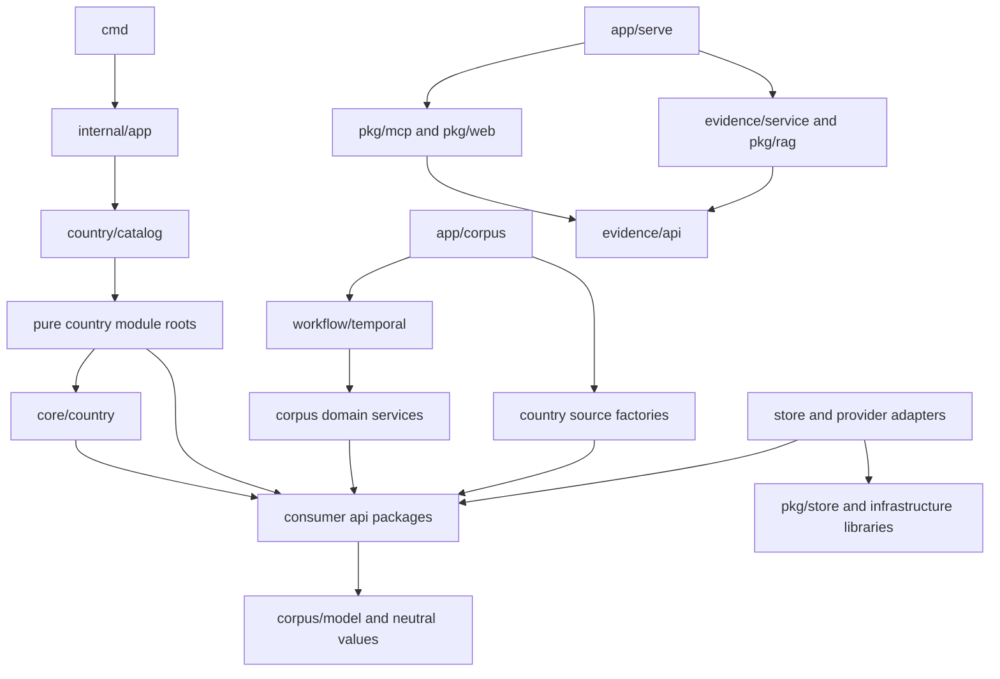

# Repository layout

Status: Proposed layout. No code moves, runtime changes, or deployments are implemented by this document.

Organize banhmi around corpus responsibilities, pure country rules, and evidence serving. Keep useful
code while replacing its contracts in bounded slices. The result must make agent ownership clear
without requiring a repository-wide move before Vietnam works.

[AGENTS.md](../../AGENTS.md) governs work. [Architecture](../ARCHITECTURE.md) describes current code.
[Country modules](../specs/country-modules.md) owns extension contracts; the
[Vietnam plan](../plans/vietnam.md) owns M0-M6, execution order, reviews, and evidence gates.
This design assigns homes to that work. It neither replaces the plan nor approves its open decisions.

## Layout decisions

**Decision:** Keep one Go module, `danny.vn/banhmi`, with responsibility-based packages.
**Why:** Country isolation needs explicit data and runtime boundaries, not separate module builds.
**Rejected:** Country forks, a blanket `internal/core` move, and a directory for every pipeline step.
**Detail:** Retain narrow existing packages. Add country and corpus packages as their first real
implementation lands. `internal/core/country` holds only registration and admission contracts.

**Decision:** Split mixed packages by responsibility while retaining their old callers.
**Why:** Source parsing, network capture, database mutation, and orchestration need different contracts.
**Rejected:** Renaming `pkg/pipeline` to `legacy` or wrapping its mutations as new activities.
**Detail:** Extract qualified computation and replace persistence. Remove an old package only after
every caller, baseline harness, and recovery path has a replacement. Git preserves retired source.

**Decision:** Retain established shared paths as part of the end state.
**Why:** Moving retrieval, auth, generated stores, or migration history adds path risk without isolation.
**Rejected:** Moving every package under `internal` merely to make the tree uniform.
**Detail:** `pkg/rag`, transports, auth, shared utilities, and generated stores remain intentional homes.
New code uses explicit constructors and consumer-owned interfaces, not a second application framework.

## Target tree

`R` means retain the current path. `N` means a proposed path. `T` means retain during migration.
Braces group sibling directories; they are not literal names. A listed path is not a request to create
an empty directory. Create each directory with its first implementation, reviewed asset, or fixture.

```text
banhmi/
├── go.mod, go.sum                         R one module
├── cmd/
│   ├── {server,mcp,embedder}/             R serving and local query model entry points
│   ├── {migrate,seed,eval}/               R explicit operator and evaluation commands
│   ├── {pipeline,ingest,lexindex}/        T old operations, then thin supported clients
│   ├── corpus-worker/                    N resource-specific worker composition
│   └── {corpus-review,review-approval}/   N separate writer API and human approval processes
├── internal/
│   ├── app/
│   │   ├── serve/                        R evidence, transports, auth composition
│   │   ├── corpus/                       N worker and source factory composition
│   │   └── review/                       N serving-side approval and audit composition
│   ├── core/country/                     N manifest, state, registry, admission types
│   ├── country/
│   │   ├── catalog/                      N single compiled module inventory
│   │   └── <code>/                       N pure descriptor and read rules; vn first
│   │       ├── grammar/                  N body, parts, identity, effects, subjects
│   │       ├── sources/<source>/         N pure request planners and sandbox decoders
│   │       ├── corpus/                   N pure worker-only source factory bindings
│   │       ├── data/{seeds,dictionaries,guide,locales}/  N versioned country assets
│   │       └── testdata/{fixtures,goldens,real}/        N fixtures and manifests
│   ├── corpus/
│   │   ├── model/                        N neutral blocks, spans, targets, observations
│   │   ├── {run,blob,release,schematest}/ R fences, object identity, releases, schema checks
│   │   ├── source/                       N bounded discovery and capture controller
│   │   ├── conversion/                   N byte conversion, maps, structure assembly
│   │   ├── {parts,quality}/              N part reconciliation and acceptance findings
│   │   ├── {relations,validity,subjects}/ N evidence reconciliation and assignments
│   │   ├── {chunking,ocr,embedding}/      N chunk computation and durable batch controllers
│   │   ├── review/                       N private API and fenced decision application
│   │   ├── store/                        N generated-query adapters and transactions
│   │   └── workflow/temporal/            R versioned workflows, activity bindings, replay
│   └── evidence/
│       ├── {api,service}/                R read contracts and shared operations
│       └── store/                        N corpus reader adapter extracted from pkg/mcp
├── pkg/
│   ├── rag/{retrieve,lexical,embed}/      R retrieval, lexical mechanics, query runtime
│   ├── {mcp,web}/                        R MCP and website transports
│   ├── {identity,oauthserver}/           R authentication with separate auth storage
│   ├── base/{config,db,dns,log}/         R shared infrastructure, explicitly composed
│   ├── {fetch,scope,eval}/               R qualified HTTP, matching, evaluation mechanics
│   ├── store/<schema>/                  R hosted-generated sqlc output only
│   ├── {app,ingest,extract,pipeline}/    T old composition, sources, extraction, mutations
│   └── base/{jurisdiction,sourceurl}/    T old descriptors and source URL compatibility
├── sql/<schema>/                        R canonical schema and query sources
├── sqlc.yaml                            R generation configuration
├── deploy/
│   ├── {migrations,authmigrations}/      R append-only chains, checksums, embedded loaders
│   ├── {seed,eval}/                     R existing embedded seeds and frozen baselines
│   ├── {aws,gcp,containerfiles}/        R existing infrastructure and image definitions
│   ├── corpus/vn/                      N isolated VNGCloud writer and worker infrastructure
│   └── vn/                             N VNGCloud serving; review/ holds approval and audit
├── config/                             R portable examples, no country policy duplication
├── tools/                              R maintenance, model export, evaluation helpers
│   └── ci/                             R hosted generation and evidence checks
├── .github/workflows/                  R hosted checks and reviewed delivery workflows
├── docs/{design,specs,plans}/           R architecture proposals, contracts, delivery records
├── instructions/                       R contributor safeguards
└── {AGENTS.md,CLAUDE.md,README.md,PLAN.md} R authority, entry points, current delivery record
```

The tree shows responsibilities, not every current command or file. Unlisted existing commands stay
at their current paths until an owned slice proves their replacement or retirement.
Use country codes `vn`, `my`, `sg`, `id`, `th`, and `kh`, not corpus brands, for module names.
Keep source package names `sbvhanoi` and `cdcgov`; their stable source IDs remain `sbv_hanoi` and `cdc`.

Keep a domain's interfaces and algorithms in its package. Add a pure `api` subpackage when country
implementations need its contracts without importing runtime code. Add concrete adapter subpackages
only for real isolation or dependency needs: `source/http`, `conversion/mupdf`,
`conversion/libreoffice`, `ocr/vision`, and `embedding/{huggingface,runpod}` are proposed homes.
`ocr/vision` names the actual provider; the current `pkg/extract/docai` code uses Vision.
Sandbox boundaries, process credentials, and task queues remain deployment contracts, not directory names.

Keep unit tests beside code. Country `testdata/floors.json` records unchanged thresholds.
Country manifests hash embedded data and test inputs. `testdata/real` stores manifests and expected
findings, never raw documents or private data. Protected storage holds hash-pinned real inputs.
`deploy/eval` remains the frozen old baseline while new country suites gain their own manifests.
Keep one writer database per country and a separate immutable database per serving release.
Country-qualified keys and singleton database metadata enforce isolation. Subjects remain assignments
within a country, not new databases, copies of documents, or source pipelines.

## Dependency rules

Arrows mean imports or constructor dependencies. Implementations satisfy ports without registration
side effects. The diagram describes the target, not a claim that all current imports already comply.



1. Composition alone chooses concrete providers, pools, country bundles, and runtime credentials.
   Domain constructors accept narrow ports. A domain never imports its own concrete adapter.
2. Each behavioral interface belongs to its consumer. Source owns capture and decoder ports;
   conversion owns body/language rules; parts, relations, validity, and subjects own their rules.
   Evidence owns query/presentation rules. `pkg/rag/lexical/api` owns tokenization rules.
3. Consumer APIs import neutral values, never their implementations, the registry, or each other.
   Move a genuinely shared value to `corpus/model`; do not create a universal `common` package.
   Neutral values contain no pgx rows, Temporal types, provider clients, or country implementations.
4. `core/country` imports only pure contracts. `country/catalog` imports pure module roots.
   Module roots never import their `sources` or `corpus` packages. Worker composition binds factories
   separately. A country never imports another country; generic tree helpers belong to conversion.
5. Serving may import pure country roots, read APIs, retrieval, and pure release selection contracts.
   Its transitive imports must exclude crawlers, converters, batch providers, Temporal, corpus store,
   and `pkg/{app,ingest,extract,pipeline}`. Keep worker adapters out of shared release packages.
6. Extract the corpus reader from `pkg/mcp` to `internal/evidence/store`; retain compatibility
   constructors until callers migrate. Evidence operations never depend on either transport.
   Both transports call the same operations and preserve stdio and Streamable HTTP contracts.
7. Auth stays separate from corpus storage. Country modules receive no accounts, tokens, or audit
   identities. Writer-side review and serving-side approval use distinct principals and listeners.

Hosted checks must enforce forbidden transitive imports, side-effect-free module construction,
disabled-country denial before I/O, and both tagged and ordinary build graphs when affected.
Vietnam queries pass the module language gate before embedding or corpus queries. The query embedder
runs on our own host. Questions never enter Temporal, OCR, or bulk embedding. No answer or reranker
model belongs in any package. Keep exactly `guide`, `corpus_status`, `quality_gaps`, `search`, `document`.

## Processing ownership

The [write-path stage contract](../specs/corpus-write-path.md#stage-contract) owns the sixteen
substeps and their semantics. The mapping below assigns code ownership without creating sixteen packages.

| Substep | Domain owner | Workflow owner |
|---|---|---|
| Discover | `source`, country planners/decoders | `SourceSync` |
| Fetch | `source/http`, capture policy and transport | `DocumentIngest`; discovery capture also serves `SourceSync` |
| Capture | `source`, `blob`, fenced `store` adapter | `DocumentIngest` |
| Detect and convert | `conversion`, sandbox adapters | `DocumentIngest` |
| OCR batch | `ocr`, Vision adapter | `OcrBatch` |
| Normalize, structure, gate | `conversion`, `parts`, `quality`, country grammar | `DocumentIngest` |
| Snapshot | `release`, fenced `store` adapter | `CorpusBuild` |
| Relations and validity | `relations`, `validity`, country grammar | `CorpusBuild` |
| Subject assignment | `subjects`, country rules/data | `CorpusBuild` |
| Chunking | `chunking`, shared token mechanics | `CorpusBuild` |
| Bulk embedding | `embedding`, provider adapters | `EmbedBatch` |
| Lexical indexing | `pkg/rag/lexical`, corpus build activity | `CorpusBuild` |
| Evaluation gate | `pkg/eval`, frozen country suites | `CorpusBuild` |
| Release build | `release` sealing and export | `CorpusBuild` |
| Publication | `release` delivery ports and destination adapter | `Promote` |
| Promotion | `release` selection and receipt contracts | `Promote` |

The [workflow spec](../specs/corpus-workflows.md#workflow-contracts) owns seven business workflows
plus `ControlReconcile`. Keep their versioned definitions and SDK bindings in `workflow/temporal`.
Use separate files for each workflow and activity family, not a generic stage interpreter.
`Reprocess` selects stored originals and starts `DocumentIngest` with fetch disabled; conversion owns
comparison reports. `ControlReconcile` repairs durable launch, notification, job, and selection receipts.
Neither workflow gains acceptance or promotion authority from its successful completion.
Activity bindings call domain services; fenced store adapters commit acceptance and receipts atomically.
Fetch workers capture bytes without parsing. Converter processes parse without network, database,
credentials, or Temporal access. Pure grammar over validated blocks can run on bounded CPU workers.

Before dependent code moves, align the country-module reuse map with `ocr/vision`, and add
`chunking` and `evidence/store` to the owning M3/M4 task paths. Update current engineering rules with
each implemented move. These proposed destinations do not override the current-path instructions.

## Path migration and compatibility

| Current home | Target action | Timing and removal gate |
|---|---|---|
| `pkg/app` | Move new corpus wiring to `internal/app/corpus` | M1 after reviewed durable adapters; retain old wiring until all direct callers retire |
| `pkg/ingest/<source>` | Split pure rules into country sources; capture into `corpus/source` | VN in M1; other countries only after M3 and their own qualification |
| `pkg/fetch` | Keep qualified HTTP mechanics; inject capture policy from `corpus/source` | M1; no module network calls or competing retry owner |
| `pkg/extract` | Adapt extraction into conversion; OCR provider into `corpus/ocr/vision` | M1-M2; retain old flat-text callers until fixtures and recovery paths migrate |
| `pkg/pipeline` parsers/effects/chunks | Split country grammar from generic conversion, effects, and chunking | M2-M3; preserve native citations and comparison fixtures |
| `pkg/pipeline` mutations/batches | Replace with domain services, fenced stores, and workflows | M1-M3; never call old mutation functions from new workers |
| `pkg/base/{jurisdiction,sourceurl}` | Move new rules and source formatting to modules | M0 contracts, later consumer slices; old descriptors serve old callers only |
| `pkg/mcp` reader and country copy | Move reader to `evidence/store`, copy to module assets | M4; preserve transport APIs and compatibility callers |
| `pkg/rag`, `pkg/web`, auth, shared utilities | Keep paths; inject country policy and release contracts | Owning M3-M6 tasks; no rename prerequisite |
| `pkg/rag` old batch adapters | Replace new production selection with corpus OCR/embedding controllers | M2-M3; retain old callers and named offline comparisons until replaced |
| `sql`, `pkg/store`, migration chains | Keep paths; append schema changes and hosted-generated output | M1 onward; never copy or hand-edit generated code or migration history |
| `deploy/seed`, `deploy/eval` | Keep existing callers; add unchanged selected VN assets to module data | M0 inventory; bind both copies to hashes until loaders switch |
| `cmd/pipeline`, `cmd/ingest`, `cmd/lexindex` | Keep names; migrate supported VN actions to fenced clients | Thin-client cutover only after rehearsal; other-country callers stay compatible |
| `deploy/aws`, existing images and scripts | Retain accepted artifacts and country behavior | VN trigger retirement needs cutover approval; other five services stay unchanged |

These path contracts block casual moves: `sqlc.yaml` output paths; CI generation guards and artifact
allowlists; embedded migration SQL/checksums; `deploy/seed` CSV embeds and suffix selection;
`deploy/eval/golden{,_id,_kh,_my,_sg,_th}.json`; Makefile floors and ONNX/OpenVINO build tags;
container build/copy commands; AWS launch scripts and operational command flags.
Any future move changes all consumers in one reviewed slice and obtains the applicable hosted evidence.
Never rename a migration file or reset its chain. Existing document renames also need a separate,
linked slice; this layout uses their current paths.

Retained old packages are a migration inventory, not a permanent dumping ground. The end state has
one new registry, one corpus execution path, pure country modules, and shared evidence operations.
Remove each old package when its last runtime, evaluation, and recovery caller has moved. Keep old
deployment artifacts for unchanged services. Disabled new modules do not authorize those services' cutover.

Import separation alone cannot protect the new writer. Give old tools no new-writer credentials or
network access, and enforce database roles plus country admission epochs. New workers receive no
old-database mutation access. Block old direct writes, `ingest -persist`, repair stages, and standalone
index rebuilds against the new writer. Recovery must use the same fenced ports as ordinary processing.
Keep the current compatibility release resolver only for old serving; the new composition must require
immutable release selection. At Vietnam cutover, revoke old Vietnam writes without changing other countries.

## Delivery and agent ownership

The first layout slice is M0.1-M0.2: neutral contracts, a frozen catalog, disabled Vietnam descriptor,
and real versioned assets/manifests. It adds no empty country skeletons, worker executable, or deployment.
Complete M0's hosted CI gates before dependent M1 work. Do not make the target tree a new prerequisite.

| Existing milestone | Layout work |
|---|---|
| M1 | Add persistence adapters, workflow composition, source split, and baseline conversion |
| M2 | Move VN grammar with parts/effects fixtures; qualify conversion, OCR, and acceptance |
| M3 | Add chunk/batch and release owners; prove retrieval parity; prepare isolated writer IaC |
| M4 | Split reader adapters from MCP; wire immutable releases, auth, and serving rehearsal |
| M5 | Wire private writer review separately from serving-side human approval and audit |
| M6 | Complete shared website/module copy and authorized thin-client cutover |
| After M3, independently | Migrate other country modules as `migrated-disabled`; never block Vietnam |

Use the plan's [parallel ownership](../plans/vietnam.md#parallel-ownership-and-handoffs), with exact
file exclusions in each brief. The following lanes are responsibility boundaries, not concurrent jobs.

| Lane | Exclusive files per assigned slice | Required handoff |
|---|---|---|
| Contracts | `core/country`, neutral model, named consumer API files | Frozen interfaces before dependent implementations |
| Country | Named country's grammar, source rules, data and fixtures | Pure outputs and fixture manifests; no shared registration edits |
| Corpus domain | One named domain and its adapters/tests | Port behavior, fences used, sandbox/provider constraints |
| Persistence | Named SQL/schema, migration additions, generated outputs, store adapters | Reviewed hosted artifacts before consumers import them |
| Workflow | Named workflow/activity files and replay fixtures | Durable-state mapping and real hosted histories |
| Serving | Assigned evidence, transport, auth, or website files with exclusions | Five-tool and auth contracts, country regression scope |
| Delivery | Assigned IaC, image, CI helper, or workflow files | Path consumers, artifact provenance, isolated evidence |
| Integrator | Catalog registration, composition, `go.mod`, `go.sum`, `sqlc.yaml`, Makefile, shared CI and document indexes | Applies reviewed lane handoffs; serializes shared-file changes |

The primary assigns one integrator per shared file and milestone; two lanes never edit that file
concurrently. At most four Codex jobs run, including reviews. Follow the repository model routing.
Design, implementation, and review have separate owners. The primary handles Git and acceptance.
Each handoff names paths, changed contracts, affected countries, evidence, missing inputs, and open findings.
Independent milestone review and required adversarial review cover the integrated diff and material fixes.

All execution checks run on GitHub. A layout draft has static evidence only. Exact-commit build,
generation, schema, replay, import-boundary, and affected-country checks gate their owning slices.
Real-document validation gates corpus claims; destination checks gate deployment claims. Missing or
skipped evidence blocks its gate. Writer and worker capacity remain separate from VNGCloud serving.
Folder organization proves neither provider parity nor a safe cutover.
