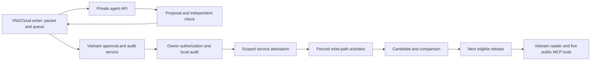

Status: Proposal. Not approved, not implemented.

# Corpus review workbench

## Purpose and limits

Check disputed corpus evidence once, retain the reasoning and source references, and deliver the correction in the next eligible release.
Build the review API first. The owner reviews through operator-run AI agents that call it; the human console is deferred on the same API.
Users receive checked evidence without repeatedly asking their own agents to reconstruct the same relation or parsing defect.
Review certifies a named assertion or source span. It never certifies an entire document merely because one item was checked.

Vietnam comes first on VNGCloud. Existing services on AWS remain unchanged.
Vietnam questions must use Vietnamese with diacritics or a document number. The serving layer validates them before any embedding or corpus query; English is interface text only.
This approved, unimplemented language gate also governs serving reviewed evidence.
Vietnam corpus generation and the private agent review API run on isolated VNGCloud writer and worker capacity in Vietnam, orchestrated by Temporal Cloud. The local approval and audit service stays beside live auth on the serving host under separate roles. The serving host runs no corpus worker or agent model.
The [write-path decision](corpus-write-path.md#decisions) keeps one fenced Vietnam writer and preserves immutable release delivery. The other five country services remain on AWS.
Our servers run no answer, generative, or reranker model. Only the query embedder is served on our own host.
Review agents use separately authorized operator sessions on public legal evidence. The application does not invoke a model, process user questions with agents, or generate answers.
Deterministic extraction remains canonical. Human decisions select evidenced mappings and assertions, not invented statutory wording.
No model output becomes canonical text. OCR remains non-binding after any review.
User questions and identifiable reviewer data stay in Vietnam. Opaque reviewer keys separate writer authority from the local directory; no reviewer directory enters Temporal, agent contexts, public releases, or hosted CI.
Public legal documents may use approved cloud batch processing; public availability alone does not clear personal data for export.

This file owns review behavior and interfaces. It creates no new acceptance path or release authority.
Implementation remains proposed. The [paired delivery plan](../plans/corpus-review.md) preserves the decision contract, opaque reviewer key, audit journal, and mutual TLS with a private CA.

## Existing evidence and inherited contracts

These are repository records, not fresh corpus validation or deployment checks.

| Record | Consequence |
|---|---|
| The [write path](../ARCHITECTURE.md#write-path) describes direct pipeline stages and no Temporal deployment. The [source plan status](../../PLAN.md#L24) leaves persistent adapters behind hosted generation. | Review delivery below is proposed work, not an operating queue. |
| [AUTH.md:3](../design/AUTH.md#L3) records implemented, undeployed Google access. Its first scope excludes a private admin website at [AUTH.md:36](../design/AUTH.md#L36). | Reuse identity and authority policy for the review API; defer console routes. |
| [schema.md:80](../design/schema.md#L80) distinguishes source relation confidence from truth; [schema.md:101](../design/schema.md#L101) records validity limits. | Retain source assertions beside reviewed resolutions. |
| [Phase 3](../design/website.md#phase-3-depends-on-the-corpus-redesign) records provision validity, amendment-target, and six-clause attribution defects. | Start with a bounded relation repair and date-boundary example. |
| [rag.md:171](../design/rag.md#L171) records existing evidence gaps and provenance summaries. | Extend the shared evidence output; preserve visible uncertainty at every detail level. |
| The [corpus quality record](../../PLAN.md#corpus-quality) records a forced rebuild that changed chunks and retrieval metrics. | Never repair review items through blanket live normalization or reindexing. |

The [shared quarantine contract](corpus-workflows.md#document-processing-and-quarantine) remains decision ID, document version ID, quality report hash, workflow fence token, actor, action, reason.
Keep its five actions: retry with another converter; accept as non-binding OCR; accept with named gaps; mark as a coverage gap and exclude; attach an alternate official source.
Only revision states `accepted` and `accepted_with_gaps` are build-eligible. The database owns those states and the intake ledger.
Reprocessing requires a before/after comparison and owner adjudication of critical changes before fenced acceptance.
Review assertions extend stage inputs. They do not add a sixth quarantine action or replace conversion provenance.

## Decisions

**Decision:** Build the review API first under owner decision 22. Use one corpus queue and private agent API at the writer, with Vietnam-local approval and audit services. Defer the human console on the same API.
**Why:** The owner reviews through AI agents calling the API. Corpus work stays beside immutable inputs and fencing; reviewer identities, approvals, and audit data stay in Vietnam.
**Rejected:** A foreign writer or review bridge would add a needless residency boundary. A second Vietnam corpus writer would split acceptance authority. Direct SQL fixes would bypass revisions and release gates.
**Detail:** Keep the shared decision contract, opaque reviewer key, audit journal, and private-CA mutual TLS in the API phase. The Vietnam approval service issues scoped local attestations to the fenced writer. Agent transport does not grant autonomous approval authority; the later console uses the same API. Technical residency, service authorization, and recovery verification precede activation.

**Decision:** Start with human approval for every corpus-affecting decision; agents only triage, propose, and independently check.
**Why:** A second model can repeat the first model's mistake. Agreement cannot establish legal truth or waive a quality gate.
**Rejected:** Confidence thresholds or two-agent voting that clear quarantine, set legal status, or replace source text.
**Detail:** Two agents may append a pre-check receipt, but no agent proposal auto-applies to evidence, eligibility, or gaps. Any future exception needs a separately approved, non-legal-meaning action allowlist and measured precision.

**Decision:** Require mutual TLS from the project's private certificate authority for both review interfaces, plus application login with multi-factor authentication for humans. Owner decision 20 settles this access choice; implementation remains proposed.
**Why:** Device certificates restrict access before HTTP; application grants still control each action. Human reviewers need access from dynamic Vietnamese consumer and mobile networks behind carrier-grade NAT.
**Rejected:** Human IP allowlists do not fit those networks. WireGuard hides the service entirely but requires a VPN client. Cloudflare Access terminates TLS abroad.
**Detail:** Terminate human TLS only in Vietnam. Agent machines with fixed addresses may add an IP allowlist as a second layer, never as a substitute for mutual TLS.

## Review item and evidence packet

A review item names one disputed assertion or bounded source region, with links to dependent items.
Fields: item ID, country, kind, document version/revision, typed provision or part target, scope, detector and recipe, reason, severity, report hash, candidate digest, expected epoch, attempt fence, due time, and affected releases.
Also retain first detection, latest observation, dependency keys, proposal references, legal-meaning class, and resolution receipt.
Deduplicate by country, version, kind, scope digest, report hash, and detector recipe. A changed input creates a linked item, never edits an old packet.
Grouping several items for one source defect preserves each item's identity and acceptance result.

An immutable packet includes captured source metadata, original artifact hashes, safe rendered pages or regions, parsed blocks/tree, quality metrics, source maps, and exact related-document revisions.
Every evidence reference binds observation, artifact hash, coordinate space, span or page/region, and citation where present.
For reflowable formats, distinguish the original package from a recipe-bound preview; preview page numbers are not source page numbers.
Null original-byte offsets retain usable page/member anchors and the declared mapping gap. Do not invent scan offsets.
Show the complete acting clause, surrounding heading, commencement clause, and target text for legal-effect items. A cropped quote alone cannot prove scope.
Missing originals, unreadable context, or absent target versions block a positive resolution; reviewers may retain the gap.

“Legal meaning” includes changes to identity, citation, obligation scope, authority, target, effect, date, or omission of relevant text.
The server assigns the highest risk across the proposed delta and dependencies. Unknown risk requires human legal review; an agent cannot lower it.

| Item kind | Detection | Evidence beyond the common packet | Allowed resolution | Legal meaning |
|---|---|---|---|---|
| Conversion quarantine | Failed conversion gate, missing pages, unsafe package, failed provenance | Page inventory, converter diagnostics, output ranges, qualified alternative recipe | One of the five quarantine actions; safety/hash failures cannot be waived | Acceptance or exclusion can change evidence scope; human approval |
| Legacy encoding decode | Competing mappings, unmapped glyphs, mixed fonts, round-trip ambiguity | Original glyph render, font/run bytes, every allowlisted decode, round-trip results, official alternative | Select an evidenced qualified mapping per run and reprocess; otherwise OCR/alternate source/gap | Yes when text changes; critical changes require owner adjudication |
| Part boundaries and Mẫu số numbering | Duplicate codes, orphan blocks, body/part overlap, catalogue mistaken for form | Full adjacent pages, issuance clause, catalogue, exact labels, parent namespace and ownership map | Select source-backed boundaries/parent/code; retain duplicate occurrences or ambiguity; never renumber | Yes: citation and scope |
| Body structure gaps | Missing subdivisions, quote ambiguity, source-tree disagreement | Source tree beside labelled blocks, full quote and next heading, coverage inventory | Derive only explicitly printed subdivisions; retain enclosing text and gap where labels are absent | Yes: citation, scope and completeness |
| Amendment targets | Unresolved selector, conflicting grammar, ambiguous target list | Operator, target phrase, recital and replacement spans, candidate targets and commencement evidence | Resolve exact target/type/extent or leave unresolved; record an ordered correspondence only with evidence | Yes |
| Relation attribution | Structured edge lacks clause support; one clause attached to unrelated edges | Each incoming edge, complete acting clause, number-role spans, source feed observation | Corroborate, reject, or leave disputed assertion; select a supported edge separately from source metadata | Yes |
| Provision validity intervals | Conflicting effects/dates, partial-document status hiding a provision repeal | Prior resolution, causal clauses, transition conditions, target descendants and date timeline | Select supported half-open intervals; keep unknown endpoints or conditional applicability | Yes |
| Part validity intervals | Form replaced/repealed while parent remains current | Issuance/replacement clause, old/new parts, attachment association and transition conditions | Resolve only the named part and evidenced descendants; preserve unaffected siblings | Yes |
| Duplicate or ambiguous document numbers | Multiple identities match a normalized number or reused consolidation number | Issuer, type, title, issue year/date, execution fields, all source observations | Select identity assertion; retain separate identities; propose evidenced merge/split mappings without deleting keys | Yes |
| Subject assignment | Missing/conflicting tags; document-wide inheritance overstates scope | Taxonomy version, target text, official classification, rule matches and context role | Assign one or more subjects; reviewed not-applicable; retain unknown; no new taxonomy through review | No statutory change, but changes discovery; human approval |
| OCR text review | Low confidence, critical-token disagreement, missing regions or table structure | Original scan/region, unchanged OCR output, engine/version, boxes and alternate official text | Confirm a bounded transcription; record a separate human correction as non-binding; exclude unsafe spans or request new OCR | Potentially yes; authority never increases |
| Source metadata conflicts | Number/date/type/issuer/status differs between observations or text | All captured observations, header and execution/commencement clauses, related effect documents | Select an evidenced metadata assertion or retain conflict; do not rewrite Bronze | Yes for identity/dates/status; other descriptive fields still require human approval |

Non-binding human OCR corrections retain before/after bytes, reviewer evidence, and their own derivative hash.
An agent may flag a suspected character and cite its region, but cannot supply replacement canonical text.
Decoding and structure corrections are typed inputs to deterministic recipes. Unsupported transformations require a rule change and reprocessing, not an editor patch to accepted text.
Relations, identity, validity, and subjects become explicit reviewed assertions beside deterministic output.

## Roles and authority

| Role | May do | May not do |
|---|---|---|
| Owner | Designate/revoke scoped reviewers; approve assertions, gap acceptance, critical reprocess adjudication, supersession/reversion and separate release promotion | Waive integrity, provenance, index or evaluation gates; make OCR binding |
| Designated human reviewer | Read assigned corpus scopes; triage; propose; independently check; approve only explicitly granted kinds/subjects and gap actions | Grant roles, self-expand scope, adjudicate critical reprocess changes, or promote a release |
| AI review agent | Read public packets; prioritize by corpus facts; identify missing evidence; propose typed decisions with citations; check another proposal | Read human identities/notes or user activity; approve legal meaning; clear quarantine; accept gaps; write accepted evidence; promote |
| Vietnam approval service | Verify live human authority and issue a scoped local service attestation | Invent a human approval or become a corpus writer |
| Fenced writer activity | Validate receipts, compute a new candidate/assessment, accept under the inherited contract | Infer approval from queue closure, agent agreement, or Temporal success |

Start owner-only for approval. Delegated approval remains disabled until [write-path question 3](corpus-write-path.md#risks-and-owner-questions) is resolved.
Recommend separate grant scopes for technical checking, legal-assertion approval, and source-gap acceptance. Technical review alone grants neither legal nor gap authority.
Require an independent human check before approval of legal-meaning changes; the proposer cannot be that checker. Normally the approver is also distinct from the proposer.
The owner adjudicates critical reprocess changes after the independent technical check recommended by [conversion question 3](document-conversion.md#risks-and-owner-questions).
The owner-only adjudication rule is the exception: if the owner proposes a critical correction, a designated human supplies the independent check before the owner adjudicates. If no checker is available, the item stays pending.
Agent checks assist but do not count as the required human check. Routine noncritical approvals still bind exact evidence and scope.

For a second agent check, use a different model identifier, separate context, and separate task credential.
The checker first reads the frozen packet without the proposal, records its assessment, then compares the proposal and cites supporting or contrary spans.
Record agreement, disagreement, or insufficient evidence, not an “approved” outcome. Shared training or provider lineage can still correlate errors.
An owner cannot resolve disagreement by counting model votes; a human checks the source.

## Append-only decisions and database mapping

Review progress and corpus acceptance are different states.
The queue projects `open`, `proposed`, `awaiting_human`, `approved_pending_apply`, `applied`, `deferred`, `expired`, and `superseded` from append-only events.
`applied` requires the writer receipt. Publication is a separate release-membership receipt, displayed as `Đã phát hành` with its release ID.
Rejected proposals remain in the audit and leave the item open unless a separate resolution closes it.

| Record | Required fields or storage mapping |
|---|---|
| Review item/events | Proposed indexed `ingest` records linked to execution, version, revision, report and typed target; mutable queue projection only. Database sibling owns physical tables and migrations. |
| Proposal | Proposal ID/version, item ID, typed delta, prior assertion references, exact retained/excluded ranges, evidence references, reason code, public source rationale, nullable confidence with scale/scope, proposer reference and creation time. |
| Agent provenance | Machine principal, provider and exact reported model ID/version, prompt template version/hash, tool/schema version, inference settings, input packet hash, output hash and checker references. An unavailable model revision is recorded as unknown, never invented. |
| Human audit | Vietnam account database, separate proposed review tables: randomly assigned stable opaque reviewer keys and their account mapping; proposer, checker, approver, account/grant epochs, scoped grants, private rationale, decisions, denials and delivery receipts. Append only, with independent Vietnam recovery journaling; no corpus snapshot or foreign backup contains the directory or audit rows. |
| Quarantine decision | Extend [database decision storage](corpus-database.md#conversion-provenance-and-decisions), keeping every shared field. Human `actor` is the opaque reviewer key linked to the Vietnam operator audit record. Add proposal/check references, signed approval attestation, separate approval issuer, prior decision, expected epoch, expiry and public evidence scope. |
| Other reviewed assertions | New immutable Silver assessment sets for `relation_assertion`, `amendment_target`, identity assertions, `validity_resolution`, `evidence_validity_interval`, and taxonomy-bound subjects. Use `silver.evidence_target` for provisions and parts. |
| Conversion correction | Revision-linked raw/normalized maps, reversible edit ledger, immutable reports and comparison hashes under the existing conversion provenance contract. No in-place text updates. |
| Application and release | `ingest.execution_result`, revision acceptance and durable delivery records commit through fenced activities. Frozen membership selects exact decision/assessment digests; Gold exports scoped review evidence and gaps. |

Decision content also binds country, processing execution, admission epoch, document version/revision, original/output/candidate hashes, quality report hash, workflow fence token, expected decision epoch, recipe/policy, action, reason and expiry.
The workflow fence token keeps its existing meaning: the execution's `attempt_fence`.
For a build-stage assertion, retain its source intake bindings and add the build input digest and build fence at application. Do not counterfeit a document intake execution or build.
Create a hash-bound relation/validity/subject report for its stage findings; do not relabel that report a conversion gate.
Source-span references supply verbatim rationale. Free-form human notes stay in Vietnam; only an explicitly reviewed public rationale may enter corpus provenance.
Confidence never substitutes for evidence, a human check, authority, or a gate. Store unknown confidence as null.

Supersede by appending a new decision that names the previous decision and affected scope. Reject overlapping active decisions unless the newer decision explicitly supersedes them.
Revert by appending a compensating decision with source evidence and current bindings. Recompute dependent targets, validity, subjects, redlines and chunks in a later candidate.
Reversion needs the same authority as the original change. It does not delete audit rows or overwrite a published release.
Keep decision and evidence closure for every referencing release, pin, hold, and live attempt under database retention. Audit retention remains an owner question below.

## Application, fencing, and residency

The writer holds review packets and previews. The separate approval and audit service on the serving host holds human assignments, reads live auth through a restricted role, and reconciles writer receipts through its outbox. It has no corpus write authority. Neither service creates competing corpus acceptance state.
The API phase uses an operator transport for explicit owner authorization, with human MFA and private-CA mutual TLS verified in Vietnam outside the agent context. No agent credential grants approval. The later console calls the same API. Keep private writer and approval traffic inside the Vietnam boundary.
Keep names, Google subjects, emails, account IDs, IPs, account/grant epochs and private notes in the approval and audit service; exclude them from writer records and agent responses.
Assign each human a random stable opaque reviewer key, never derived from identity claims. Human decision records and signed attestations carry proposer, checker and approver keys; the writer's `actor` is the approver key.
The approval-service principal is the separate approval issuer, not the human actor. Agent principals are non-personal service identities.
Keep the reviewer directory and key-to-person mapping exclusively in Vietnam, linked to the operator audit by decision ID and reviewer key. Keys are pseudonymous, not anonymous; omit them from public releases, agent responses and Temporal signals.
This preserves the [conversion decision contract](document-conversion.md#quarantine-and-review) with identifiable audit data separated from writer records by opaque reviewer keys.

1. Persist the proposal, exact packet and human approval locally and durably journal directory links, approval and dispatch intent before issuing a permit or acknowledging approval. Approval records expire with the item's deadline, or after 24 hours for items without a quarantine deadline.
2. The approval service rechecks account status, authorization epoch, grant scope and grant epoch on each dispatch and retry. Role revocation invalidates queued approvals.
3. Issue a signed, one-use service permit for the exact decision digest, reviewer keys, approval issuer, country, execution, report, fence, epoch, action and writer audience, expiring within 60 seconds. Use a service authorization epoch, not a human epoch. Authenticate the approval service separately and pin its verification keys.
4. Serialize permit issuance and role revocation locally. A permit already issued may commit until its short expiry; report that bounded in-flight window. Emergency revocation also fences writer admission. No distributed atomic-revocation guarantee is claimed.
5. A fenced activity validates the permit, current country admission, execution/lease/fence, expected decision epoch, input/report hashes, action scope, expiry and policy. Commit the decision receipt and notification records atomically.
6. Send only `quarantine.decision.v1 {decision_ref, expected_epoch, expected_report_hash}` where that existing signal applies. Temporal carries no identities, rationales or source text. Reconciliation reads durable receipts after lost acknowledgements.
7. Retry/alternate-source decisions create linked work. `ApplyComparison` precedes `ApplyEvidence` for reprocessing. Acceptance reruns mandatory gates on exact retained/excluded ranges and requires owner critical-change adjudication.
8. Build-stage assertions apply through the corresponding fenced relations/validity/subject activity. Snapshot only approved decisions at the build cutoff; late approval starts a later build, never changes a frozen manifest.
9. The next eligible release carries accepted corrections after evaluation and separate owner promotion. Existing serving databases remain immutable; approval is not publication.

Acquire a fresh permit with current local authority checks immediately before each corpus-affecting application, including `ApplyEvidence` and build-stage assertion acceptance. An earlier `ApplyDecision` receipt cannot bypass revocation or approval expiry.
Permit consumption and the writer result commit together. A retry first checks for a committed receipt; it never reuses a consumed permit for different work.
Expiry or role revocation blocks unapplied work, not previously accepted evidence. Later builds may reuse immutable accepted assessment receipts without renewed human approval; a new delta requires current authority.
Same decision and payload return the prior receipt; changed payload under the same ID fails. New fence, epoch, report, source bytes or recipe requires a new bound proposal/approval, not automatic restamping.
No human wait holds a parser slot, execution lease, database connection or transaction. An approval-service outage leaves decisions pending and serving on its last verified release.
An expired quarantine closes as an unresolved gap. A late decision creates a linked attempt under the workflow contract; it cannot reopen the expired attempt in place.

## Review API first

Recommend a small CLI backed by a private HTTPS API on the isolated VNGCloud writer side. An internal MCP adapter may expose the same operations later.
The API runs beside public packets and queue receipts, not on the serving or approval host. It has no access to accounts, queries, sessions or private review notes.
Its TLS listener requires a valid private-CA device certificate with a non-personal service identity before accepting HTTP. Explicit owner approval uses the separate Vietnam approval service through the operator transport; no human certificates, directory, IP logs or certificate-to-person mapping enter writer records. The human console is deferred.
The owner reviews through operator-run agents calling this interface in bounded offline sessions. No review model runs on our servers and no user request starts agent work.
Reject public `/mcp` tokens and browser cookies. Public MCP retains exactly its five tools and `mcp:read` scope.

| Operation | Contract |
|---|---|
| `list_queue` | Country/kind/priority filters within granted scope, keyset cursor, maximum 50 items; no reviewer assignment names or user-hit telemetry. |
| `get_item` | Exact item/packet hash, typed scope, parsed output, official metadata and related evidence; maximum 256 KiB text per page, explicit continuation. |
| `get_evidence` | Catalogued artifact/page/region only; maximum 8 MiB per response, at most four regions. Oversize returns a gap or smaller documented region, never silent truncation. |
| `propose_decision` | Append a typed proposal with evidence references and expected epoch/report; maximum 64 KiB. Schema validation is not acceptance. |
| `check_proposal` | Append an independent assessment bound to proposal and packet hashes, model/prompt identity and cited differences. Reject same-model checks as independent evidence. |
| `get_receipt` | Return proposal/check/application status and public reason codes; omit human identities and private audit data. |

Use separate short-lived workload credentials per agent task, bound to audience, country, assigned item set, tool allowlist and expiry of at most one hour.
Issue credentials outside the model context; a local transport injects them. Deny direct database, object-listing, cloud-control, shell, promotion and approval privileges.
Start at 30 reads/minute, six proposal/check writes/minute, two in-flight requests and 100 MiB/hour per task; enforce global limits of four tasks and 400 MiB/hour.
Overload returns a retryable limit result; retries preserve proposal idempotency. Budget exhaustion stops the task and leaves the item pending.
The server validates cited ranges against packet bytes, target membership, permitted action schema and model separation. It cannot validate legal truth by syntax alone.
Bind model identity to the approved task runner's provenance, not only the model's self-report. Missing provenance makes a check unverified and ineligible to count as independent.
Agents cannot fetch arbitrary URLs. A missing related document becomes a bounded write-path discovery request after human triage.

## Human console, deferred

Build this console later on the same review API. Its routes, layouts, browser sessions and browser checks below are outside the API-first phase; authority, mutual TLS, human MFA, audit and recovery already apply to the API.
Add private `GET /quan-tri/duyet` and `GET /quan-tri/duyet/{item}` on a dedicated Vietnam review origin and TLS listener, with protected `/api/review/v1/...` endpoints. The public website listener exposes none of these routes.
Use the existing Google account identity, current status and session epoch checks described in [AUTH.md:168](../design/AUTH.md#L168) and [AUTH.md:183](../design/AUTH.md#L183).
Require application multi-factor authentication (MFA) after Google login, using a locally verified second factor with enrollment and recovery records in Vietnam. A client certificate or an assumed Google MFA setting does not replace this check.
Use host-only review sessions and a registered callback on the review origin. Bind the session to the enrolled device; require fresh MFA for grants, approvals and factor/device recovery.
Default deny: a normal active account has no review rights. The owner grants country, kind, subject and action scopes with expiry; email never grants authority.
Store grants and grant events locally, separate from corpus snapshots. Check grants and account state on every read/write and before permit issuance; block and revocation fail closed.
Require same-origin checks, cross-site request forgery (CSRF) protection and explicit POST actions. Public MCP bearers never authorize these endpoints.
Keep `no-store`, `noindex`, self-hosted assets and `no-referrer`. Do not cache private packets in browser storage or service workers.
Require reviewers to access private identity/audit views from the approved Vietnam access boundary. Offshore reviewer access would export personal data and is not authorized by a reviewer grant.
Add only the two console path shapes to validated login continuation; allow a bounded opaque item ID, no arbitrary URL, query or fragment. Recheck authorization after login.
This needs a separate review-origin composition and extends the continuation contracts in [AUTH.md:68](../design/AUTH.md#L68) and the [site map and access boundary](../design/website.md#site-map-and-access-boundary); it does not relax public-origin or host checks.

| Area | Layout and Vietnamese controls |
|---|---|
| Queue | Left rail filters `Loại vấn đề`, `Mức ưu tiên`, `Chủ đề`, `Nguồn`, `Trạng thái`. Rows show citation, kind, impact band, age, due time and `Cần người duyệt`; sort reasons are visible. |
| Item header | Document number, native citation, source version, scope, legal-meaning warning and `Bản đang phục vụ` / `Bản chờ phát hành`. Show stale-packet status before any action. |
| Evidence pane | Left 50%: `Bản gốc`, page/region selector, zoom, source metadata. Right 50%: `Kết quả phân tích`, structure tree, selected span and source-map highlight. Wide tables scroll without losing headers. |
| Context | Tabs `Văn bản liên quan`, `Hiệu lực`, `Nguồn và lỗi`, `Đề xuất`, `Nhật ký`. Human identities appear only in authorized local audit views. Legal text remains Vietnamese. |
| Reprocess comparison | Switch `Trước / Sau`; synchronize source anchors, not assumed page numbers. Show insertions/deletions, moved boundaries, changed citations, critical tokens, authority and every added/removed gap. |
| Decision tray | Typed target/date/range selectors, source references, required reason, affected-count preview; `Đề xuất`, `Yêu cầu bổ sung`, `Giữ khoảng trống`, or role-limited `Duyệt`. Owner adjudication is a separate explicit action. |
| Result | Distinguish `Đã lưu đề xuất`, `Chờ áp dụng`, `Đã áp dụng`, and `Đã phát hành`. Show writer conflicts and receipts; never show success merely because a signal was sent. |

Keyboard flow: `j/k` selects the next/previous row outside text inputs; Enter opens; Tab moves between panes and controls; `[`/`]` moves pages; Escape closes overlays and returns focus.
Use a labelled confirmation dialog for approval with the exact delta, exclusions and legal effect. No single-key approval shortcut. Announce conflicts and state changes to screen readers.
On narrow screens use `Bản gốc` and `Phân tích` tabs with retained selection, plus a fixed action tray that does not cover text.
Batch actions allow assignment, deferral and repetitive proposal preparation for at most 50 explicitly selected items. Show every item and hash; never select unseen results.
Batch approval is limited to noncritical, non-legal-meaning items of the same kind and action, with per-item evidence, reason and preconditions. Commit each independently and report partial failure.
Legal effects, identity, OCR critical tokens, gap acceptance and critical comparisons require individual confirmation. No “approve all agent matches” action.

## Queue order and service targets

Compute user impact on the Vietnam host using aggregate search-result exposure counts, not stored questions or per-user histories.
After a successful search, increment at most once per returned evidence key per request. Store only daily key/count buckets for 30 days, with no account, IP, query, vector, session or request ID.
Do not log search payloads or use click tracking. Show only seven-day count bands with at least ten exposures; smaller counts remain “insufficient usage data”.
Counts and priority calculations stay in Vietnam. The writer can rank by public corpus facts; human scheduling may request public item IDs without exporting usage telemetry.
Counts measure exposure, not unique users, correctness or unmet searches. Rate limits reduce manipulation; popularity never decides truth or hides unseen documents.

| Priority | Rule and proposed target |
|---|---|
| P0 | Published evidence with a credible wrong legal effect, identity or critical text: owner triage within four staffed hours; containment decision within one staffed day. |
| P1 | Effective or soon-effective instrument, blocked release, or many dependent provisions: triage within one staffed day; resolution or explicit evidence-gap decision within three calendar days. |
| P2 | Remaining ambiguity, metadata or subject work: triage within three calendar days; resolution or deferral within seven calendar days. |

Within each priority, sort by due time, then seven-day exposure band, owner-curated importance tier, current/next-30-day effect, distinct dependent target count, age and item ID.
Store the priority policy version and inputs. Reserve 20% of review slots for the oldest low-exposure items and random audits to avoid starvation.
Importance tiers use reviewed document classes and scope, not an agent's legal opinion. Count unresolved dependencies explicitly.
These are proposed service-level targets, not measured staffing capacity or promises to resolve uncertain law.
Use the workflows spec's proposed 24-hour reminder and seven-day quarantine expiry; its owner question governs both. Expiry records a gap, never acceptance.
Escalate missed targets to the local owner queue. A deferral cannot reset quarantine expiry or erase age.
After approval, target inclusion in the next daily candidate within 24 hours if dependencies and gates are ready. Promotion remains separate; report approval-to-release lag and the exact blocker.
For P0, the owner may choose an existing safe retained release through `Promote`, or fence affected service access while preparing a replacement. Never hot-edit a published corpus.

## User-facing evidence

Publish a review summary per assertion/span: state, scope, decision reference, evidence references, reviewed revision, public reason code, and release ID.
States are `unreviewed`, `agent_prechecked`, `human_reviewed`, and `disputed`. These do not replace validity, text authority, acceptance, or coverage.
Only an applied human decision selected by the release can produce `human_reviewed`. An agent check never produces `Đã duyệt`.
Changed text, source, target, recipe-dependent mapping or report invalidates carry-forward unless an explicit equivalence receipt proves the reviewed scope unchanged.
Keep old releases' summaries unchanged. Show refresh health separately when a later issue disputes evidence still in the active release.

| Surface | Required behavior |
|---|---|
| Search | Show `Đã duyệt: quan hệ` or another exact scope beside the affected evidence. Use `Chưa duyệt`, `Đang có ý kiến khác`, and existing gap warnings where applicable. Never promote a review marker to a green legal-validity stamp. |
| Reader | Add `Kiểm tra dữ liệu` with checked spans, source evidence, reason and release. Display reviewed/expected counts by aspect; unchecked siblings retain their own state. |
| Citations and export | Preserve native citation bytes. Add release, revision, source hash and scoped review metadata separately. Citation copying and evidence handoff retain OCR, date and gap warnings. |
| `search`, `document` | Add bounded review summaries through the shared evidence service; compact retains state/scope/gaps, standard adds references, full pages detailed public reasons. No names, agent-generated legal prose or private proposals. |
| `quality_gaps`, `corpus_status` | Count unresolved, agent-prechecked and human-reviewed targets separately with denominators and release identity. Expose outstanding gap kinds, not the private work queue. |
| `guide` | Explain review scope, non-binding OCR, unknown validity and how to follow cited evidence. Keep five public tools. |

Subject review feeds the database's assigned/unknown/not-applicable assessments and possible-match policy, not a new strict-filter default.
The write path computes redlines from exact before/after targets; database stores them; website displays them. Review selects or disputes the inputs, never generates consolidated law.
Durable evidence keys come from the database identity contract. Merges, splits and supersession retain historical keys and explicit ambiguous/unavailable outcomes.

## Quality loop

Each accepted correction records a regression manifest with input hashes, rule/prompt versions, decision references, expected typed outputs, exact citation/target/date expectations and negative cases.
Keep synthetic minimal fixtures and public manifests in Git. Store real public originals and derived goldens outside Git in the protected fixture store; retain no reviewer identity in hosted artifacts.
Human reviewers establish gold truth. Use conversion's independent annotation and owner adjudication requirements; agent text cannot define expected canonical words.
Group recurring items by detector and recipe. Improve a deterministic rule when one source-backed rule covers the class, then compare all affected items and an independent holdout before reprocessing.
A rule improvement removes future manual work only after hosted regression and real-document gates; it does not silently retire old decisions or rewrite released evidence.
Measure proposal precision as human-accepted unchanged proposals divided by all human-adjudicated proposals, separately by kind, model/prompt and legal risk. Compute human-linked metrics in Vietnam; agents receive no reviewer identifiers.
Report edited, rejected, unresolved and unreviewed counts separately. Agreement between agents is not precision; confidence is not calibration without human outcomes.
Use a stratified random adjudication sample, including low-confidence proposals and disagreements, to avoid measuring only easy approvals.
Report sample size, uncertainty, critical false proposals, missing-evidence detection, queue age, reviewer minutes, reopen/revert rate and approval-to-release latency.
Do not train or tune on the held-out family set. Keep retrieval evaluation separate from agent workflow evaluation and preserve existing floors.

## Security, certificates, and recovery

Review API TLS listeners, and later console listeners, require and verify a client chain from the project's private certificate authority (CA). A missing, expired, revoked or untrusted certificate fails the handshake before login or any HTTP route.
For Caddy, set `client_auth` mode `require_and_verify` and a trust pool containing only the project CA; add a revocation verifier. These are distinct controls in the [Caddy TLS documentation](https://caddyserver.com/docs/caddyfile/directives/tls).
Check the signed certificate revocation list (CRL) on every handshake. Reject missing, expired, invalid or older CRL versions; fail closed until the current durable revocation sequence is loaded. Disable TLS resumption unless every resumed handshake proves the same check.
Do not assume Caddy's chain verification checks revocation. Hosting must supply and pin a reviewed CRL verifier and prove its handshake behavior before exposure. Prevent direct backend access and reject spoofed certificate headers.
Issue one certificate per device for at most 90 days. Bind human devices to the local reviewer directory; use separate human and service issuing intermediates, with each listener trusting only its intended intermediate.
Keep certificate subjects opaque. Distribute service-certificate revocation data only within the private Vietnam review boundary. Human certificate records, revocation data, edge logs and device mappings stay in the approval and audit service.

| Lifecycle | Required control |
|---|---|
| CA custody | Keep the root key offline under owner custody in Vietnam. Keep the issuing key on an isolated Vietnam host or the owner's machine in Vietnam, with restricted signing access and encrypted recovery copies in Vietnam. Never copy CA private keys to CI or any foreign service. |
| Issue | Owner verifies the person or service and device through a separate trusted channel, approves enrollment, and journals it. The device generates its key and submits a certificate signing request; private keys stay on that device, non-exportable where the platform allows. No shared device keys or foreign key backup/sync. |
| Renew | Notify before expiry; recheck active device, current grants and human MFA or service authorization. Generate a new device key and certificate, journal the replacement, and revoke the old serial after installation. Expiry never permits a bypass. |
| Revoke | Journal the serial and reason first; fence the affected listener while distributing the new signed CRL. Reopen only after durable CRL sequence acknowledgement. Close existing connections, revoke bound sessions/task credentials and pending approvals, and apply the approval service's in-flight permit rule. |
| Lost device | Report through a separate trusted channel; owner revokes the device certificate immediately, blocks its sessions and pending authority, and replaces any exposed factor. Re-enroll a replacement device only after independent identity verification; never restore the lost private key. |
| CA compromise | Fence affected listeners and approval authority; use the offline root to replace a compromised issuing intermediate, revoke its chain and re-enroll devices. Root compromise requires a new trust root and verified redistribution before reopening. |

Treat legal text, metadata, PDFs and proposal rationales as untrusted data. A document may contain instructions aimed at an agent.
Place source content in delimited evidence fields, never in tool descriptions or system instructions. Tool access and allowed actions come only from the task policy.
No shell execution, embedded link following, credential access, external callback, prompt change or tool installation can follow from document text.
Validate proposals as data and reject unknown fields, unsupported actions and references outside the assigned packet. Human approval cannot waive these checks.
Generate inert previews only through conversion's isolated untrusted-byte workers; do no conversion or OCR on the Vietnam serving host.
Escape text and filenames, disable active content, serve with restrictive content security policy, and enforce hosting's download byte/concurrency/time limits.
Keep separate principals for queue reads, proposal writes, approval attestation, fenced application, release promotion and audit reading. Agents receive only the first two.
Use runtime-injected secrets, encrypted Vietnam audit storage/backups, append-only audit writes and restricted export. No secret or personal-data values enter diagnostics.
Audit role grants/revocations, packet access, proposals, checks, decisions, rejected writes, application receipts and reverts. Log IDs and reason codes, not copied request bodies.
Hosting must provide an encrypted, signed, append-only Vietnam recovery journal independent of the auth database and its backup lifecycle. Its ordinary five-minute auth recovery loss cannot apply to acknowledged review authority or approvals.
Journal reviewer-directory links, grant changes, approvals with their audit/evidence bindings, dispatch intents, device enrollment and revocation before issuing permits or acknowledging those changes. Retain a complete checkpoint and ordered tail; deny overwrite/delete to the routine writer.
Fence review authority on failed or ambiguous journal writes. Reconcile durable intents with local state before acknowledgement; unresolved revocations deny access, and uncertain grants or approvals confer no authority.
After auth loss or restore, fence review access and permit issuance until journal continuity, current blocks/grants, directory links, CRLs and audit/outbox state reconcile with writer receipts. Revoke restored sessions and permits; never recover review grants through a corpus rollback.
An applied writer decision newer than the backup must recover its human audit from the independent journal. Missing continuity keeps the fence closed. Replay an intent only after checking its receipt and current authority; never redispatch a stale approval.

The owner has settled residency: personal data at rest, in backups, logs and at the edge stays with Vietnam providers; no cross-border dossier is required under this boundary. Apply [hosting's residency contract](vngcloud-hosting.md#security-and-residency) without reopening that decision.
Google sign-in is a transient OAuth exchange, not a transfer of stored personal data. Exchange the one-time code, verifier, callback and client credentials for transient tokens; retain subject and verified email only in Vietnam and discard provider tokens. Never attach questions to OAuth state or callbacks. See [Google OpenID Connect](https://developers.google.com/identity/openid-connect/openid-connect) for exchange mechanics.
Keep identifiable audit, private notes and restricted source material in Vietnam; withhold restricted packets from agents and external processors. Never silently redact the canonical original to make it eligible for external processing. Verify provider replication, backup, log, edge and recovery-key locations before activation; require independent adversarial review of auth, service authorization and recovery enforcement.

## Worked example and acceptance requirements

The 09/2020/TT-NHNN case is a repository-recorded requirement, not a new legal finding: [Phase 3](../design/website.md#phase-3-depends-on-the-corpus-redesign).
The required result is khoản 6 Điều 22 of 50/2024/TT-NHNN targeting Điều 25 of 09/2020/TT-NHNN, with repeal from 2025-01-01.
The other five incoming clauses lack that target in the reported case. Do not infer their correct targets or discard their source assertions without checking each clause.
The [official 50/2024 listing](https://vbpl.vn/nganhangnhanuoc/Pages/vbpq-toanvan.aspx?ItemID=171687) could not be retrieved for this proposal. Captured hashes, rendered pages and commencement evidence remain required.

1. Freeze both official versions, the six assertions, current target mappings and prior release. Open linked attribution, target and provision-validity items; do not quarantine unrelated sound text automatically.
2. Show all six complete clauses, highlight operator/target/recital/replacement spans, and compare the exact Điều 25 text plus commencement provisions. Agents propose per-clause dispositions and independent checks.
3. A human checker verifies the source packet; the owner approves the initial legal assertions and any critical reprocess change. Missing commencement evidence leaves the effective date unresolved.
4. Fenced application appends a supported relation and exact target, supersedes unsupported projections, and creates a validity resolution. Preserve the source feed assertions and rejection reasons.
5. End the prior supported interval at 2025-01-01 without inventing its start; begin the repealed interval there. Propagate whole-article repeal only to evidenced descendants. Leave the document and unrelated provisions independently assessed.
6. Build a candidate that shows only the supported clause in this incoming target view. Check 2024-12-31 and 2025-01-01, separate acting and target citations, unchanged body text, and exact redline inputs or an explicit unavailable difference.
7. After evaluation and owner promotion, show the scoped `Đã duyệt` marker and provision repeal in website/MCP outputs. Old release links retain their prior evidence; compensation and release rollback remain auditable.

The [delivery plan](../plans/corpus-review.md) owns implementation slices, dependencies, hosted evidence, external proof, and remaining owner decisions. None is reported complete here.

## Sibling interfaces

| Sibling | Review consumes | Review supplies; ownership stays with sibling |
|---|---|---|
| [Corpus write path](corpus-write-path.md) | Stage reports, acceptance policy, owner authority, frozen build cutoffs | Approved typed assertions and decision references; only its fenced activities accept, build and promote. Gap acceptance follows question 3; placement follows its approved orchestration decision. |
| [Corpus workflows](corpus-workflows.md) | Intake attempts, decision epochs/fences, quarantine due times and durable receipts | Persisted decisions through the existing signal/outbox contract; reminders and seven-day expiry retain the sibling's semantics. No reviewer polling activity or second completion ledger. |
| [Document conversion](document-conversion.md) | Blocks, original/preview geometry, maps, edit ledger, quality reports and comparisons | Exact mapping/scope decisions and critical-change adjudication; conversion reruns gates and owns byte extraction. Keep opaque reviewer keys at the writer and actor identity in the Vietnam audit store. |
| [Document parts](document-parts.md) | Part namespaces, labels, boundary findings, association/coverage and shared targets | Reviewed boundary/identity assertions with source spans; parts owns classification, citations and display. Keep XLSX search/file-only and presentation metadata limits. |
| [Corpus database](corpus-database.md) | Intake/acceptance ledger, immutable revisions, assertion sets, release membership and retention | Indexed review extensions with human actor keys linked to Vietnam operator audit and a separate approval issuer; database owns schema, constraints, sqlc, serving closure and fenced transactions. Reviewer keys stay outside serving snapshots. |
| [Embedding models](embedding-models.md) | Input/recipe hashes, fixed retrieval baselines and compatible runtime contract | Changed accepted text/context hashes only; reuse compatible vectors, rebuild required lexical projection, run affected goldens. Review grants no model switch or query egress. |
| [VNGCloud hosting](vngcloud-hosting.md) | Vietnam auth/control storage, preview delivery, restore fences and resource limits | Dedicated review TLS listener, CA custody/CRL enforcement, local approval API/directory/audit/outbox, independent durable review journal, and deferred console. Extend its block journal to cover review authority before activation; account backups and usage aggregates stay in Vietnam. No corpus worker or conversion on serving. |

Online retention is the active release plus at least two prior releases, kept for at least 30 days, plus any release under an explicit pin or hold.
Only one embedding model runs on the serving host at a time, under the [embedding runtime policy](embedding-models.md#migration-and-rollout-slices).
Before replacing the runtime, re-embed every release that stays in dense search, or retire older releases from dense search.
Retired releases remain available through `document` and lexical search, with a visible gap. Retention, pins, and holds still protect their evidence and recipe artifacts.
Dense search requires a matching query runtime (same model, tokenizer, recipe and dimensions). No dual-runtime capacity is reserved. Host sizing follows the [dedicated small vServer decision](vngcloud-hosting.md#workload-and-sizing); grow only from measurement.

The [delivery plan](../plans/corpus-review.md#remaining-owner-decisions) records unresolved approvals and delivery inputs. Approval of this specification would not approve implementation, deployment, source-gap policy, or release promotion.
