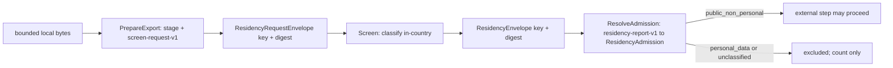

Proposal, not approved, not implemented. The [Vietnam plan](../plans/vietnam.md#m113-initial-quality-and-residency-gate) owns delivery as M1.13 phase 2. Phase 1, the persisted codecs under `internal/corpus/quality/formats/`, is approved and merging; this spec consumes them. The report, roll-up, and policy bundle formats and the outcome precedence are fixed in [conversion formats](document-conversion-formats.md#policy-and-gate-reports) and are not redesigned here. The residency classification policy in this spec has legal effect and needs owner approval before implementation.

# Quality gate and residency screen

This spec owns two implementations of the frozen `internal/corpus/quality/api` ports: `api.Gate`, the pure per-artifact quality gate, and `api.ResidencyScreen`, the in-country residency screen that admits an artifact to external processing. [Document conversion](document-conversion.md#quality-gate-and-authority) owns metric definitions and thresholds. [Acceptance](corpus-database-acceptance.md) verifies retained reports. [Hosting](vngcloud-hosting.md#security-and-residency) owns the data-flow residency table.

## Gate: Evaluate

`quality.Gate` implements `api.Gate`. `Evaluate(api.GateRequest) (api.QualityEvaluation, error)` is pure: no I/O, no clock, no randomness, no logging, no goroutines. It calls `GateRequest.Validate()` first and returns an error on failure. Bounds come only from `Document.Limits` and `Parts.Limits`, which `Validate` already enforces; the gate allocates in proportion to the validated item and byte counts and never reads a referenced asset. The same input always yields byte-identical metric and finding arrays.

The profile is trusted. Metrics follow `Profile.Metrics` order exactly, one metric per requirement, with `Mandatory` and `Threshold` copied from the requirement. The policy bundle sorts `artifact_profile` by `kind`, so profile order is kind order.

**Decision:** Interpret `MetricRequirement.Threshold` with a closed grammar: `qualification-required`, `min:<decimal>`, or `max:<decimal>`.
**Why:** The frozen type is a string and the M1.12 fixture already uses `qualification-required`. The gate must decide `Passed` from it.
**Rejected:** Free-form thresholds, or pass rules inside the policy bundle, which has fixed rule B keys.
**Detail:** `quality.ParseThreshold` returns a `ThresholdRule`. `min:x` passes when `Numerator/Denominator >= x`; `max:x` passes when `Numerator/Denominator <= x`; `qualification-required` never passes a measured value and forces `unknown`. An unparseable threshold is a policy defect: `Evaluate` returns an error and no report. Decimals are compared as exact rationals, never floats.

### Metric computation

Text-bearing blocks are kinds `heading`, `paragraph`, `list_item`, and `table`. A block is excluded when a `Parts.Exclusions` span names its `BlockID`; excluded blocks leave the text denominators and their spans are copied into `Exclusions` in producer order. A partial exclusion span without a block ID is not applied and yields an `info` finding `EXCLUSION_NOT_APPLIED`. A measured metric with a zero denominator becomes `unknown` with reason `NO_ELIGIBLE_INPUT`; the gate never reports a score of 1 for an empty set.

| Kind | State in M1.13 and computation |
|---|---|
| `geometry` | `unknown`, reason `BASELINE_UNQUALIFIED`. `DecodedDocument` carries no page or region geometry. |
| `fidelity` | `unknown`, reason `BASELINE_UNQUALIFIED`. No qualified comparison input exists. |
| `page_accounting` | `unknown`, reason `PAGE_INVENTORY_UNAVAILABLE`. No independent page inventory reaches the gate. |
| `text_coverage` | `unknown`, reason `REGION_INVENTORY_UNAVAILABLE`. Empty text-bearing blocks yield a `warning` finding `EMPTY_TEXT_BLOCK`. |
| `corruption_rate` | Measured. Numerator: code points in included text-bearing `NormalizedText` that are U+FFFD, C0 or C1 controls other than tab, line feed, carriage return, and form feed, private-use U+E000 to U+F8FF, or the ported mojibake markers below. Denominator: all code points in that text. |
| `diacritic_validity_rate` | Measured, language-neutral. A cluster is a Latin letter with at least one diacritic: a precomposed non-ASCII Latin letter or a letter followed by combining marks U+0300 to U+036F. Malformed: a combining mark after a non-letter or at text start, or more than two marks on one base. Numerator: well-formed clusters; denominator: all clusters. A Vietnamese orthography table is a country rule bound later; see the extension below. |
| `structure_completeness` | Measured when `Parts.ClassifiedRanges` or `Parts.Namespaces` is nonempty: numerator is blocks owned by exactly one classified range or exclusion, denominator is all blocks. Empty parts: `unknown`, reason `PARTS_RESULT_EMPTY`. |
| `citation_parse_rate` | `unknown`, reason `CITATION_GRAMMAR_UNAVAILABLE` until country grammar is bound. |
| `table_integrity` | `unknown`, reason `TABLE_INVENTORY_UNAVAILABLE` when any `table` block exists; otherwise `unknown`, reason `NO_ELIGIBLE_INPUT`. `DecodedBlock` has no cell content. |
| `metadata_agreement` | `unknown`, reason `METADATA_UNAVAILABLE`. No observation metadata reaches the gate. |
| `provenance_completeness` | Measured. Numerator: blocks with at least one source span whose `ArtifactHash` equals `Document.OriginalHash` and that validates as a ranged or anchored unavailable mapping. Denominator: all blocks. Edit reversal is acceptance's check, not this metric's. |

Unknown metrics carry `Passed = false`, zero counts, the profile threshold, the reason code, and nil evidence and exclusions, exactly as the M1.12 observation report does. Successful conversion cannot qualify geometry or fidelity; only a later qualified producer can.

**Decision:** Accept an optional `conversionapi.LanguageRules` at construction, `quality.NewGate(quality.Options{Language: rules})`, and merge its `Inspect` metrics for `diacritic_validity_rate` and `citation_parse_rate` when bound.
**Why:** Vietnamese orthography and citation grammar are country rules under [country modules](country-modules.md), and the frozen `Gate` interface has no country parameter.
**Rejected:** Importing `internal/country/vn` from core; a Vietnamese alphabet table hardcoded in core.
**Detail:** M1.13 binds nil. A bound rule set may replace the two metrics above only for kinds it reports; it cannot add kinds outside the profile, change mandatory flags, or touch other metrics. Its findings append after gate findings.

### Findings and order

Findings use `Scope = artifact` and `ScopeKey = string(Document.OriginalHash)`. Spans copy the affected block's `SourceSpans` unchanged in their native coordinate spaces; the gate never invents aggregate normalized-text offsets. The array order is fixed:

1. Metric findings in profile order: an unknown metric yields `GEOMETRY_UNKNOWN` for geometry, `FIDELITY_UNQUALIFIED` for fidelity, and `<KIND>_UNKNOWN` otherwise; a failed measured metric yields `<KIND>_FAILED` with the offending blocks' spans. Severity is `blocking` when the requirement is mandatory, otherwise `warning`.
2. Ported legacy text findings, per block in ordinal order, then document-level, in this code order: `TEXT_REPLACEMENT_CHARS`, `TEXT_PUA_RUNES`, `TEXT_MOJIBAKE_MARKERS`, `TEXT_CYRILLIC_MOJIBAKE`, then `TEXT_TOO_FEW_LETTERS`, `TEXT_HIGH_WHITESPACE`, `TEXT_LOW_DIACRITIC_DENSITY`, `SOURCE_PLACEHOLDER`. All are `warning`.
3. Gate structural findings: `EMPTY_TEXT_BLOCK`, `EXCLUSION_NOT_APPLIED`, in block order.
4. `Parts.Findings` appended unchanged in producer order.
5. Bound `LanguageRules` findings, when any.

**Decision:** Port the signal arithmetic of the legacy text gate at [extract.go:187](../../pkg/extract/extract.go#L187) into `quality/textsignals.go` with characterization fixtures, and emit its signals only as findings.
**Why:** The plan reuses those findings as findings, not qualification. Legacy code is frozen and new corpus code must not import `pkg/extract`.
**Rejected:** Importing `pkg/extract`; carrying its confidence score or pass verdict into any metric or outcome.
**Detail:** Frozen constants, versioned `legacy-text-signals-v1`: bad ratio 0.01, private-use ratio 0.005, mojibake marker set `√∆·ªƒ∫≠‚ÄØ` at count 8 and ratio 0.005, Cyrillic count 8 and ratio 0.005, minimum 50 letters, whitespace ratio 0.40, diacritic density 0.02 at 200 letters or more, and the `Đang cập nhật` placeholder rule. The gate does not normalize text; `NormalizedText` is NFC by contract, and a block that is not NFC yields `warning` `TEXT_NOT_NFC` with no repair.

### Outcome and report mapping

`Evaluate` returns `accepted` when every mandatory metric is measured and passed and no finding is `blocking`; otherwise `quarantined`. It never returns `needs_ocr` or `accepted_with_gaps`: the frozen `GateRequest` carries neither an OCR request nor a decision binding. The consumer composition applies the fixed precedence from the formats spec: `needs_ocr` replaces `quarantined` when the work requests OCR; `accepted_with_gaps` requires a bound decision, a rerun of `Evaluate` with the decision's excluded ranges projected into `Parts.Exclusions`, an `accepted` result over the retained blocks, and a nonempty gap set. `GateResult.Validate` then requires the report outcome to equal the declared outcome.

`quality.BuildReport(eval, request, binding) (model.QualityReport, error)` is pure and maps the evaluation into the frozen report value: `ArtifactHash = Document.OriginalHash`, `CandidateDigest = Document.CandidateDigest`, `Report` set to the self-reference sentinel `{reports/self, 64 zeros, 0}`, `PolicyHash = Profile.PolicyHash`, `ThresholdVersion` and `DecisionRef` from `quality.ReportBinding`, and metrics and findings unchanged. It validates the result against the profile before returning. The phase 1 codec then encodes `gate-report-v1` with the request, document, and sandbox manifest references for a converted artifact or three nulls for an unconverted one.

`quality.MissingConversionReport(originalHash, candidateDigest, profile, thresholdVersion, reason)` returns the bounded quarantine report for an unconverted artifact: every profile metric `unknown` with the given reason and one `blocking` finding of the same code. The reason is one of `CONVERSION_MISSING`, `RESOURCE_LIMIT`, or `REPORT_LIMIT`; the last records an oversized report or edit that the M1.5 adapter would reject.

`quality.RollUp(input) (RollUpValue, error)` is pure and computes the `gate-rollup-v1` outcome, `MissingOrdinals`, retained partition, and gap set from the artifact reports, candidate input ordinals, OCR-request flag, and optional decision scope, following the precedence and ordering rules in [policy and gate reports](document-conversion-formats.md#policy-and-gate-reports) without restating them. It rejects a decision scope whose gap or retained arrays differ from the computed ones.

## Residency screen

`residency.Screen` implements `api.ResidencyScreen` and, structurally, the `ExportScreens` seam that [capture](../../internal/corpus/source/capture.go) already calls: `PrepareExport` stages bytes and returns an `api.ResidencyRequestEnvelope`; `Screen` classifies; `ResolveAdmission` returns the `model.ResidencyAdmission`. The three calls share one in-country `residency.Store`. The screen uses only deterministic rules the policy names: Go `regexp` (RE2, linear time), byte-exact allowlists, and media-type checks. No model, no dictionary lookup against a service, and no third-party processor.

### Subjects and manifest

Two subject kinds are screened. `egress_request` is the canonical outbound request bytes that capture produces for every hop, including redirects and AIA fetches: method, URL, and headers. `artifact_text` is the text of a captured artifact before an external step: the aggregate normalized text objects that M1.12 conversion produced inside the sandbox, plus the declared filename, media type, and source title strings from the observation. Raw binary bytes are never screened by pattern; a subject with no deterministic text is `unclassified`.

**Decision:** Give the screen its own local manifest, `screen-request-v1`, and report, `residency-report-v1`, both rule A JSON encoded and decoded in `internal/corpus/quality/residency/`.
**Why:** `api.ResidencyRequest.Artifact` is a `model.CaptureRef`, which requires a transport receipt and response hash. Outbound request bytes exist before any response, so they cannot form a valid `ResidencyRequest`. The frozen envelope carries only a key and a manifest digest, so the manifest format is the implementation's.
**Rejected:** A placeholder `CaptureRef`; changing the frozen `api` type; carrying bytes or class in the envelope.
**Detail:** `screen-request-v1` is `{SchemaVersion, Kind, Subject model.AssetRef, Policy model.AssetRef, Budget model.ResourceBudget, Capture *model.CaptureRef}`. `Kind` is `egress_request` or `artifact_text`; `Capture` is required for `artifact_text` and null otherwise. `Subject` names the staged bytes under `screen/<digest>`. The envelope key is `screen-` plus the first 32 hexadecimal characters of the SHA-256 of the manifest bytes; the store resolves it. `api.ResidencyRequest` remains the typed value for the `artifact_text` kind.

### Budget and isolation

The effective byte bound is `min(Budget.MaxInputBytes, policy.max_bytes)` and the elapsed bound is `min(Budget.MaxElapsed, policy.max_elapsed_ms)`. Exceeding either, or a cancelled context, yields `unclassified` with reason `BUDGET_EXCEEDED`; it is not an error, because a classification error would let a caller retry its way around the screen. Detector match counts stop at `policy.max_recorded_matches`; the report marks truncation.

**Decision:** Run `artifact_text` screening inside the M1.11 sandbox on `corpus-converter-v2` through a `residency` child; run `egress_request` screening in the capture worker process with the same `residency.Engine`.
**Why:** Artifact text originates from untrusted documents and the frozen port says the screen reads inside the sandbox. Outbound request bytes are produced by our own capture code, bounded by `MaxInputBytes`, and screened on every hop under the capture deadline; a sandbox launch per hop would spend that deadline on process setup.
**Rejected:** A sandbox per hop; screening artifact text in the worker process.
**Detail:** Both paths are in-country on the isolated writer capacity. The engine is one pure function, `residency.Classify(policy, kind, bytes) (Report, error)`, so both paths produce identical reports for identical bytes. Reviewers should confirm that the in-process egress path satisfies the port comment "inside the local sandbox"; this spec reads the isolated capture worker as inside that boundary.

### Classification and policy asset

`model.ResidencyClass` is the closed set: `public_non_personal` admits; `personal_data` and `unclassified` fail admission. Precedence: budget or cancellation gives `unclassified` `BUDGET_EXCEEDED`; an unscreenable media type or no deterministic text gives `unclassified` with `MEDIA_TYPE_UNSCREENABLE` or `NO_SCREENABLE_TEXT`; any detector reaching its `min_matches` gives `personal_data` `PERSONAL_DATA_DETECTED`; otherwise `public_non_personal` `ADMITTED`. A manifest or policy that fails to resolve or verify is an error with a fixed reason, `MANIFEST_MISMATCH` or `POLICY_UNAVAILABLE`, and no envelope.

`ResidencyRequest.Policy` names a `residency-policy-v1` asset, rule B JSON with these exact keys:

| Key | Content |
|---|---|
| `schema_version, country, rule_version` | Version strings and writer country. |
| `max_bytes, max_elapsed_ms, max_recorded_matches` | Positive integers. Proposed, unmeasured defaults 1048576, 5000, 64. |
| `screenable_media_types` | Byte-ordered allowlist of media types whose text may be screened, initially `text/plain` and `text/html` for egress and the UTF-8 normalized-text media type for artifacts. |
| `forbidden_query_keys` | Byte-ordered URL query and header names that fail an `egress_request` outright, for example `email`, `token`, `name`, `phone`. |
| `detectors` | Array sorted by `code` of `{code, kind, pattern, min_matches, scopes}`. `kind` is `regex`; `pattern` is RE2 syntax; `scopes` is a nonempty subset of `egress_request` and `artifact_text`. |
| `instrument_admission` | Optional. `{enabled, source_ids, instrument_types}`; when enabled, an `artifact_text` subject with no screenable text may still be admitted for OCR only if its capture source and declared instrument type match, with a mandatory re-screen of the OCR text before embedding or publication. Disabled in the M1 synthetic bundle. |

Proposed initial detectors, all `min_matches` 1 unless noted: `VN_CCCD` twelve digits with word boundaries; `VN_CMND` nine digits with word boundaries, `min_matches` 2 to limit collisions with document numbers; `EMAIL`; `VN_PHONE` for `+84` or leading `0` followed by nine digits; `VN_TAX_CODE_PERSONAL` ten digits preceded by `mã số thuế`. Signatory names and titles of officials acting in official capacity are not detected: every legal instrument carries them, and no deterministic rule separates them from other names. These detectors and that exclusion are a legal-effect policy and need owner approval; see owner questions 1 and 2.

### Report, envelope, and sinks

`residency-report-v1` is `{SchemaVersion, ArtifactHash, PolicyHash, RuleVersion, Kind, Class, ReasonCode, Detectors, Truncated}` with `Detectors` an array of `{Code, Count}` in policy order. It contains no matched text, no offsets, no URL, and no filename. The report is retained in-country as a Bronze object with an execution retention edge through the M1.15 catalog, `CaptureSource = quality`, and its `AssetRef` becomes `ResidencyAdmission.Report`. It never enters an export, a batch manifest, a workflow payload, or a log.

`model.ResidencyEnvelope` carries only `Key` and `Manifest`, the digest of the report bytes; its `MarshalJSON` validates both before emitting them. The envelope does not carry the class. A rejection is therefore invisible outside the writer: the caller learns it only from `ResolveAdmission`, which reads the local report. Errors from every residency function are fixed reason constants; none embeds input bytes, keys, URLs, or paths. The package has no logger. Callers may log only the reason constant and counts.

The admission gates these external steps, each of which must hold an admitted `ResidencyAdmission` whose `ArtifactHash` equals the SHA-256 of the exact bytes it is about to send and whose `PolicyHash` equals the pinned policy: every outbound capture hop (coded in M1.10); OCR request building and submission to Google Cloud Vision in `OcrBatch` `Prepare`; bulk embedding batch manifests to Hugging Face Jobs or Runpod Flex in `EmbedBatch` `Prepare`; and protected real-fixture upload for the Q lane `fixture-admission`. A rejected or unscreened artifact is omitted from the batch manifest and counted in the batch gap record as a count with reason code, never by key. In-country steps, conversion, acceptance, review, and serving, need no admission. The ledger refuses to register OCR or embedding work for an artifact without an admitted report.

## Synthetic privacy sentinels

`internal/corpus/quality/sentinels` exports `Sentinels() []string`, the fixed set tests plant and then prove absent. It extends the six values the frozen `api` test already uses, `Jane.Doe`, `synthetic.person@example.invalid`, `Jane Doe`, `people/Jane.Doe`, the `example.invalid` person URL with that email, and `/tmp/Jane.Doe`, with Vietnamese-shaped values that no real record can hold: `Nguyễn Văn Sentinel`, `sentinel.person@example.invalid`, CCCD `000000000000`, CMND `000000000` twice, phone `+84000000000`, and `mã số thuế 0000000000`. Every value is syntactically detectable by the proposed detectors and uses reserved or all-zero digits.

Tests plant sentinels in: a capture URL query and a response header in the `egress_request` fixtures; an HTML body, a DOCX paragraph, and a declared filename in the `artifact_text` fixtures; and the `ScopeKey`, `Path`, and `Member` fields of a gate request to prove the gate copies no free text into reports. `AssertAbsent(t, sinkName, bytes)` fails when any sentinel appears, with a message that names the sink and the sentinel index, never the sentinel.

Negative checks, all required: encoded `ResidencyRequestEnvelope`, `ResidencyEnvelope`, `CaptureEnvelope`, and `QualityEnvelope` bytes; every error string returned on the rejection path; `residency-report-v1` bytes for a `personal_data` classification; the `gate-report-v1` bytes of a report over sentinel-bearing blocks; a test logger buffer captured around the capture and screen calls; a synthetic `OcrBatch` and `EmbedBatch` manifest built from one admitted and one rejected artifact, which must contain the admitted hash and only a count for the rejected one; and, in M1.14, the recorded Temporal history of a rejected export. A screen whose policy is replaced by an empty detector set must admit the same fixtures, proving the tests are sensitive to the policy and not to a hidden allowlist.

## Owner questions

1. **What counts as personal data for screening?** Luật Bảo vệ dữ liệu cá nhân 91/2025/QH15 was published in Công Báo 971 and 972 and takes effect on 01/01/2026 per the [Công Báo listing](https://congbao.chinhphu.vn/detail/tai-ve?id=45578&slug=91-2025-qh15). Điều 2 khoản 1 defines personal data as data that identifies or helps identify a specific person, and Điều 20 covers transfers to storage or processing outside Vietnam; this task confirmed both only through a [secondary mirror](https://hethongphapluat.com/luat-bao-ve-du-lieu-ca-nhan-2025.html/dieu-20), not the first-party PDF. Recommendation: screen identifiers only, as listed, and do not treat official-capacity signatory names as blocking. This has legal effect; approve before implementation.
2. **Detector thresholds.** Recommendation: `min_matches` 1 for all detectors except `VN_CMND` at 2; false positives only exclude, and exclusion is visible as a count.
3. **Who may override `personal_data` or `unclassified`?** `model.DecisionKind` has no residency action. Recommendation: no override in M1; M5 adds `admit_residency_exception` with its `00002` CHECK change, owner-only under O8.
4. **Scanned artifacts with no text.** Recommendation: approve `instrument_admission` for normative instrument types from allowlisted official sources with a mandatory post-OCR re-screen; otherwise no scan reaches Vision. Legal effect; approve before implementation.
5. **Egress screening in-process.** Recommendation: accept the in-process path for self-produced request bytes as described.
6. **Residency report retention.** Recommendation: retain reports as Bronze objects with execution edges, never exported; no expiry until the sources retention question closes.
7. **M1 synthetic profile mandatory set.** Recommendation: `geometry`, `fidelity`, `corruption_rate`, and `provenance_completeness` mandatory; the other seven non-mandatory with thresholds `min:1`, `min:0.995` for diacritic validity, and `max:0` for corruption. Production values remain under O7.
8. **OCR and decision substitutions.** Recommendation: keep them in the M1.14 consumer composition rather than open a contract slice to add fields to `GateRequest`.

## Frozen contract constraints

The frozen `api`, `model`, and formats could not express the following; each is an open item, not a change.

- `GateRequest` carries no evidence `AssetRef`, so pure `Evaluate` can never emit `not_applicable`; empty denominators are `unknown` with `NO_ELIGIBLE_INPUT`.
- `GateRequest` carries no OCR-request flag or decision, so `Evaluate` returns only `accepted` or `quarantined`.
- `GateRequest` carries no page, region, table-cell, or observation metadata inventory, so four metrics stay `unknown` in M1.13.
- `Gate` has no country parameter; the optional `LanguageRules` constructor dependency is the binding point.
- `api.ResidencyRequest.Artifact` requires a complete `CaptureRef`; the screen's own `screen-request-v1` covers request bytes.
- `screen-request-v1` and `residency-report-v1` are new persisted formats outside the approved formats list; their codecs live in the residency package, and the owner may later move them under `formats/`.
- `Finding.Scope` is a `GapKind`; gate findings use `artifact`.
- `MetricRequirement.Threshold` has no grammar; this spec proposes one.
- `model.DecisionKind` has no residency override action.
- `pkg/extract` is frozen legacy and cannot be imported; its signal arithmetic is ported.

## Freeze list for the implementation slice

Owned paths: `internal/corpus/quality/{gate,metrics,thresholds,findings,textsignals,report,rollup}.go` and matching `_test.go`; `internal/corpus/quality/testdata/`; `internal/corpus/quality/residency/{engine,policy,manifest,report,screen,store}.go`, `sandbox_linux.go`, `cmd/screen/main.go`, matching tests, and `residency/testdata/`; `internal/corpus/quality/sentinels/sentinels.go`. Excluded: `internal/corpus/quality/api/`, `internal/corpus/quality/formats/`, every `model`, `run`, `source`, `conversion`, and store package, and all workflow code.

Exported identifiers: `quality.Gate`, `NewGate`, `Options`, `ReportBinding`, `BuildReport`, `MissingConversionReport`, `RollUp`, `RollUpInput`, `RollUpValue`, `ThresholdRule`, `ParseThreshold`, `TextSignals`, and the reason-code constants above; `residency.Screen`, `NewScreen`, `Engine`, `Classify`, `Policy`, `ParsePolicy`, `Manifest`, `Report`, `Store`, `MemoryStore`, and the reason constants; `sentinels.Sentinels` and `AssertAbsent`.

Required tests and negatives: byte fixtures for `screen-request-v1`, `residency-report-v1`, and `residency-policy-v1` with absence cases; determinism, same input twice is byte-equal; profile order and exact-count rules; unknown mandatory geometry or fidelity cannot pass; a forged `Passed` or `Mandatory` in a report fails `BuildReport`; unparseable threshold returns an error; text-signal characterization against the ported constants with a negative control that disables one signal and fails exactly its case; excluded blocks leave denominators and appear in `Exclusions`; `MissingConversionReport` validates under every profile; `RollUp` rejects a decision scope with a different partition; the residency precedence table, budget overrun as `unclassified`, manifest and policy mismatch as fixed errors, every sentinel fixture classified `personal_data`, the empty-detector control, and the full sink inventory above.

Hosted checks: the plan names `privacy-contracts` and `converter-sandbox` in a `vietnam-intake.yml` that does not exist; the [hosted check matrix](../../instructions/verification.md#hosted-check-matrix) lists only `hygiene`, `gitleaks`, `semgrep-sast`, `semgrep-sca`, `generation`, `go`, `browser`, and `auth-postgres`. Until the I lane lands, the pure gate, residency engine, and sentinel tests run under the required `go` job as short tests, and the Linux sandbox child test follows the M1.11 precedent of running in `go`. The plan entry should record this mapping and the missing lane. Independent adversarial review covers residency screening, authority propagation, and acceptance inputs.
